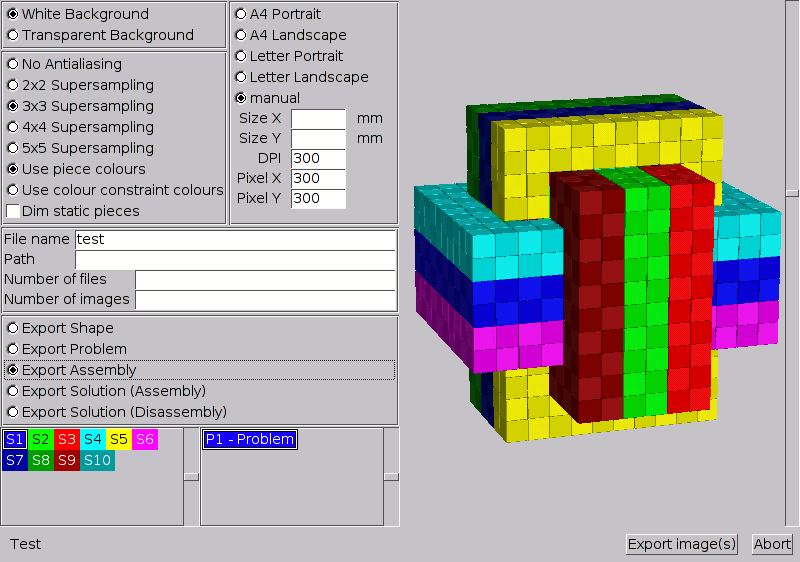
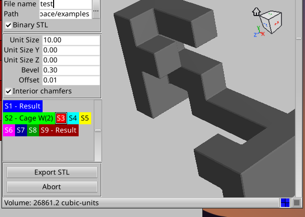

# Reporting with BurrTools

BURRTOOLS comes with some extra features to assist you in making puzzle
solution sheets, either for your personal archives or to be issued with your
exchange puzzles and commercially produced puzzles. Currently, these
capabilities are very basic and need to be improved in a future update of the
program. So, don't expect too much from them right now, but rather consider
them to be merely a preview of coming attractions.

## Adding Comments {#ChAddingComments}

The ***Edit Comment*** entry on the menu bar opens a new window that allows you
to add textual information to the puzzle file. It can be used to append extra
information such as the name of the designer, or a 'to do' list for your own
designs.

## Exporting Images {#ChExportingImages}

The ***Export - Images*** entry on the menu opens a window that allows you to
export a portion of the current puzzle to (a list of) images (see Figure
[ImageExport](#FigImageExport)). On the right the window has a 3D view, and
on the left it has input elements that control what is being created. On the
very bottom of these controls you can select what you want to create images of.
Depending on what is present in the puzzle, the following things can be
exported:

<figure id="FigImageExport">

<figcaption>Figure: The image export window</figcaption>
</figure>

***Shape***
:   An image of a single shape (a shape that was made on the entities tab) is
created. You can select which shape with the shape selector below.

***Problem***
:   An image containing all shapes that are used for a problem is created. Again
you will find the problem selector below that is used to select which problem
you are going to create images of.

***Assembly***
:   An image showing the positions of the pieces in an assembly is created. You can
select the problem. The first assembly of that problem is exported.

***Solution***
:   An image containing all steps necessary to disassemble a problem is created. In
this case you also select the problem with the selector below. The images will
be created for the last solution of that problem.

What to export is the first thing that you have to select. Naturally only the
choices are available for which the puzzle has data. So if you have not run the
solver on the current puzzle, it is impossible to export solutions or
assemblies.

Above these selectors you find the file output parameters. First the name and
the path to where the images are supposed to be created. If you give no path,
the images are put into the working directory of the program. The file name is
just a prefix, so if you keep 'test' as file name you get files of the form
'test000.png', 'test001.png', ... . (BURRTOOLS creates only PNG image files)

Finally, you can say how many images you intend to create. BURRTOOLS will try
to do so, but might use less. If you only have one assembly to export, only one
page can be created. The ***Number of images*** entry is ignored by the
software for the time being, it will be used later on.

Above these input elements you find the last section that defines your output.
Here you can define the quality and some additional parameters that influence
how the images look, but not what is to be seen.

In the top left corner you find the definition of the background of the image.
You can choose between transparent or white. Transparent is useful if you want
to have a background with patterns or want to further edit the images.

Below you find the settings for the oversampling factor. The higher that is,
the smoother the images will look, but the more memory and calculation time is
required.

Below you can choose whether you want to use the constraint colours for the
output or rather the default colour of the shapes.

The checkbox ***Dim static pieces*** makes BURRTOOLS draw pieces that are not
involved in the current move in a lighter colour, so that the pieces actually
moving are easier to spot. This, of course, only works when exporting
solutions.

Finally there are the parameters for the image size that the program creates.
There are 2 choices: either define the pixel size directly, or define the size
of the image in millimetres and the DPI printer resolution. If you want to
create A4 or letter sized images for printing, you can use the predefined
sizes.

To position the shapes in the output images, you can use the 3D view at the
right of the export window. All images exported will use the same settings for
angle and zoom as in that 3D view. If the shapes reach above or below the 3D
view they will be trimmed. Left and right is different. The width of the images
to generate is not fixed. So the program will make them quite a bit wider to
accommodate the horizontal spread of the pieces.

When you have finished with all settings, press ***Export Image(s)***. You
will see a flurry of images in the 3-D view. The program draws the shapes there
and grabs the content from the display. This may take a while. First the size
of the images is determined, then the images are drawn in the required high
resolution for the output. The progress can be seen on the left beside the 2
buttons. You will see how many images are finished and how many there are
overall.

Hint: If you get unexpected results and broken images, try to do nothing while
the images are exported. On Linux it is forbidden to change the virtual desktop
because then nothing is drawn.

The export facilities are far from what we want them to be, many important
features are missing, so you can expect some progress in later versions of
BURRTOOLS.

## Exporting Vector Images {#ChExportingVectors}

As well as the bitmap images explained in the section above BURRTOOLS can also
export vector images in various different formats. These images have the
advantage of being freely scalable without loss of precision.

The vector image export doesn't have functionality to export a complete
assembly or disassembly sequence, but only one image. The image exported is the
one currently visible in the 3D view.

To export that display into a vector image select ***Vector Image*** from the
*Export* menu. A small window will open which lets you select the possible
image format and the file name. You have to append the right extension to the
file name on your own.

The export may take a while (a few seconds up to a minute or so) and within
that time the application is unresponsive so please be patient.

## Exporting to STL {#ChExportingSTL}

STL, which stands for Standard Triangulation Language or Standard Tesselation
Language is a file format used by stereolithography software. STL-Files
describe the surface of 3-dimensional objects. BURRTOOLS can export single
shapes into STL files so that 3D printers can quickly fabricate prototypes of
them.

### Introduction to 3-D printing

There are two popular forms of 3-D printing: SLS and FDM.

The SLS (ShapeWays and TNO) laser sinters nylon. ShapeWays currently charges by
the volume of sintered nylon. SLS pieces are always white.

FDM (Stratasys) charges by the time it takes to make the piece. It has two
modes: solid and sparse. Sparse mode is quicker and uses less material. In
sparse mode the interior of the pieces are honeycombed.

Having a hollowed piece will be cheaper and quicker for SLS — it will be the
same cost and speed for FDM because a hollow piece will still have a support
structure inside the hollow, but it will be of a different material. The thing
to realize is that with SLS, if there are no holes to the hollow part of the
piece, the nylon "sand" will be captured. This should not be a problem except
for the weight of the piece. But keep in mind that some printing services will
charge you for the surrounded volume as well as the for the actually printed
volume.

### Exporting

The main menu entry ***Export - STL*** opens the window seen in Figure
[StlExportWindow](#FigSTLExportWindow). The window has a shape selector, a 3-D
view of the selected shape and some parameters that control the shapes created.
The exact parameters depend on the grid of the current puzzle. The 3-D view
displays the shape the same way as it will be exported into the STL file, so
you can see what the shape will look like. The file is written next to your
puzzle by default, and a failed write is reported instead of silently
producing nothing.

On the bottom in the status line you can see what volume the current shape with
the current settings has.

In the status line are also two buttons to choose how the shape is displayed.
Either normally from the outside. The 2nd view will show you the inside of the
shape. This is useful if you print hollow shapes and need to see what the
internal void looks like.

<figure id="FigSTLExportWindow">

<figcaption>Figure: The STL-Export window (showing older options)</figcaption>
</figure>

To export a whole solution at once, use ***Export Solution to STL*** on the
*Solver* tab instead: it writes one file per distinct piece, named after
the shape, so a complete piece set is a single click away.

### Hollow Shapes

There are mainly 2 different exporters. One for the sphere puzzles and one for
all other polygon based puzzles.

When creating spheres you can simply create hollow shapes by giving the inner
radius a value that is different from zero. The resulting shapes will
automatically have a lot of holes that connect the inside and the outside.
Those holes will be symmetrically placed and they are in places on the sphere
where they normally don't interfere with solving.

For polygon based puzzles what you model is what you get: the export follows
the voxels of the shape and chamfers all of its outer edges. (The old tube
feature, with wall thickness, tube size and holes drilled by shift-clicking
faces, has been removed in favour of the chamfer mesher.)

### Parameters

The following parameters control the generated shape and file.

***Filename*** and ***Path*** control the name and path of the generated file.
Those are common parameters for all grids. New exports default to the folder
the puzzle was loaded from.

***Binary STL:*** controls whether a binary or a text STL file is created.
Normally binary files are the right choice because they are much more compact.
But sometimes it might be useful to use the text form. For example when you
want to see what is going on in the inside of an STL file, or when your
printing service has problems with the binary file.

For polyhedron based grids there are the following parameters that control the
shape of the generated pieces. All sizes are in output units.

- ***Unit Size:*** controls the base length of the created voxels. ***Unit Size Y*** and ***Unit Size Z*** allow different sizes in the other
  directions for non-cubic pieces; leaving them at zero uses the base size
  everywhere.
- ***Bevel:*** controls the size of the chamfer on the outer edges of the
  piece. Chamfered edges print more cleanly and assemble more smoothly than
  razor-sharp voxel edges.
- ***Offset:*** allows a gap between the pieces, so that it is actually
  possible to assemble them. If the shapes were made to correct sizes they
  would touch, making movement impossible.
- ***Interior chamfers:*** also chamfers the concave (inner) edges of the
  piece, not just the outer ones. Turn it off if your printer struggles with
  the extra geometry.

Coplanar faces are always merged into larger triangles, which keeps the files
much smaller while staying watertight.

For spheres the parameters are as follows:

- ***Sphere radius:*** controls the gap between the centres of the single
  spheres. It also is the maximum radius the spheres can have. This value is in
  output units
- ***Connection radius:*** controls the radius of the connection cylinder
  between the spheres. As the spheres mathematically only touch in one point
  connectors need to be added. Those connectors are cylinders. The radius of
  those cylinders can maximally be so that they touch one another. If this value
  is 1 then the cylinders have their maximal radius, 0 would mean no connection.
- ***Curvature radius:*** controls the radius of the transition between sphere
  surface and cylinder surface. If this value is 0 no transition is done and
  there will be a bend in the surface. If the value is 1 the maximally possible
  area will be used to go from sphere surface to cylinder surface. When there is
  only little or no space for the transition (e.g. when the connection radius is
  close to 1) there might be a bend, even when this value is close to 1.
- ***Offset:*** just like with the other grids this makes the spheres smaller
  to make the puzzle actually assembable. This is in output units. Keep the
  values small if you want to have working puzzles. Most puzzles might not even
  require a value larger than zero. But you can get cool mathematical objects
  with a bigger offset
- ***Recursions:*** controls the number of used triangles to approximate the
  surfaces. A value one bigger will result in approximately 4 times as many
  triangles and accordingly smoother surface but also bigger STL files. Don't
  make it too big as it will result in long calculation times and huge files!
  Normally a value of 3 or 4 is enough.
- ***Inner radius:*** controls the radius of the hole inside the sphere. This
  radius must be smaller than the sphere radius from above. The difference of
  these 2 values defines the wall thickness of the sphere. The Offset is
  applied to both values in the same way so that the wall thickness stays
  constant.
- ***Hole diameter:*** controls the diameter of the hole that connects the void
  inside the sphere with the outside world. If you leave that value 0 the
  inside of the sphere will be completely surrounded by the sphere itself and
  material inside the sphere can not get out. Depending on the printing process
  that might not be a wise choice.
- ***Square Hole:*** the hole from above can be round or square. This is mainly
a matter of taste, so make your choice.
