# Shapes {#ChShapes}

## Spacegrids

Currently BURRTOOLS handles cubic grids, grids that use prisms with a base
shape that is an equilateral triangle tightly packed spheres and 2 grids based
on different tetrahedrons: the rhombic and the tetra-octa grid. The spacegrid
is used for all shapes within a puzzle, so you cannot have one shape made out
of cubes together with one using another grid. The spacegrid needs to be set
*before* you start with the puzzle. It cannot be changed later on In some
situations though it is possible to losslessly convert the complete puzzle
(→[Converting Puzzles](#ChConvert)). The gridtype is selected when you use the
*New* option.

The following chapters will explain some details regarding some of the
available grids.

### Sphere Grid Limitations

Actually there is just one important thing to know about the sphere grid: It
has a relatively severe limitation. This limitation makes it impossible to
properly handle shapes with disconnected units.

I don't want to go into too much detail here but the limitation comes from the
fact that BURRTOOLS can only handle a finite number of symmetries.

Internally BURRTOOLS has a list of all possible transformation matrices that
might transform a shape back onto itself, e.g the shape looks identical to the
original untransformed shape. This list of transformations needs to be finite
(and as small as possible, because longer lists make the program slower).

Unfortunately the sphere grid has an infinite number of transformations that
might transform the shape onto itself. To display the problem let's assume
we use the sphere grid in just 2 dimensions and use a square arrangement of
spheres. We place one sphere at the origin and add 2 more spheres so that both
of those additional spheres have the same distance from the sphere in the
origin. If we now place one of the 2 spheres at coordinate (a;a) and the other
at (a;-a) then both of them will have the same distance from the sphere in the
origin.

The 3 spheres form a triangle with a right angle at the origin. This triangle
has a symmetry axis which is a horizontal line from the origin. That means a
rotation of 180 degrees around the axis y=0 will result in an identical looking
triangle with the outer spheres swapped. This is one of the transformations
mentioned above that BURRTOOLS has to check. (See
[Sphere Grid Problem](#FigSphereGridProblem) left image)

If we now move the 2 outer spheres by one unit each. One to the right and the
other down. Which results in those spheres at positions (a+1;a-1) and
(a-1;-a-1). We again get a rectangular triangle of a slightly different size.
This triangle again has a symmetry axis but this axis is slightly rotated clock
wise. This would be a different transformation BURRTOOLS has to handle. (See
[Sphere Grid Problem](#FigSphereGridProblem) right image)

You can imagine that there is an infinite number of possibilities to place the
spheres, resulting in an infinite number of possible rotation axis and thus an
infinite number of transformation matrices.

BURRTOOLS can only handle a finite number of possibilities. I have limited
those to the possibilities that you can encounter when you use only completely
connected shapes. This problem only occurs because the sphere itself has an
infinite number of possible rotation axes.

Connected in this context means that that it is possible to get from each
sphere to each other sphere by just jumping from one sphere to the 12 possible
neighbours and then further on via the neighbours.

Some of the unconnected shapes might be possible as well but there is no
warrant, so if you want to be sure stay with "proper" sphere shapes.

<figure id="FigSphereGridProblem">
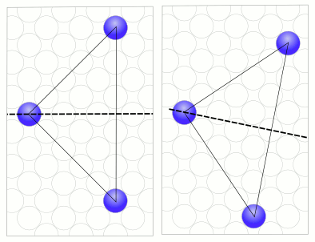
<figcaption>Figure: Sphere Grid Limitation</figcaption>
</figure>

### The rhombic grid

This grid allows the modelling puzzles that have diagonally cut cubes, but more
importantly it allows modelling a lot of rhombic dodecahedral based puzzles
like Stewart Coffin designs.

The rhombic grid is much more intricate compared to basic grids like the cube
grid. So please read this part of the manual thoroughly to avoid problems.

Much of the text below only talks about the rhombic based puzzles and indeed
puzzles that just have diagonally cut cubes don't suffer the complexity but I
still suggest to read on because it might shed some light on some of the not so
obvious things that the program does.

#### Structure of the rhombic grid

The basic unit of the rhombic grid is a tetrahedron that results when cutting
the cube along the 6 45 degree diagonal planes. The result are 24 identical but
irregular tetrahedra. To see what I mean have a look at the image below. It
contains 2 different versions of the cut up cube. One where the tetrahedron
assemble the complete cube and another exploded version of the same cube. To
make distinction of the tetrahedra easier I have colourized the tetrahedra
layer by layer, always 4 with the same colour. Additionally I made the voxels
variable in the first cube so that is is easier to see what shapes they have.

Those variable voxels are a nice trick to see the inner structure of shapes,
when the bevel edges are not enough.

<figure id="FigCuttingTheCube">
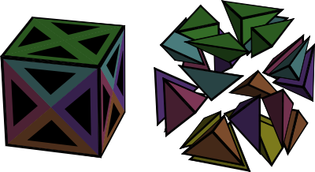
<figcaption>Figure: Cutting of the cubes into the units of the rhombic grid</figcaption>
</figure>

The next important thing to know is how are these 24 tetrahedra managed. The
picture below shows how it is done.

<figure id="FigMappingRhombicVoxels">
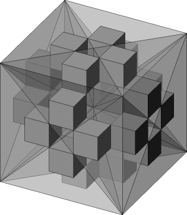
<figcaption>Figure: Mapping of the rhombic tetrahedra to a cube grid</figcaption>
</figure>

It can be seen that the 25 voxels of the rhombic grid are mapped onto a 5x5x5
cube of little cubes. Each tetrahedron is represented by exactly one cube.

Between those 24 cubes are 125-24 = 101 empty cubes that don't belong anywhere.
It you ever do something manually and modify the grid directly you must take
care to always leave those cubes empty or BURRTOOLS will crash. But as long as
you only use the program it will take care that that doesn't happen.

Now given those basic units how to we build a rhombic dodecahedron from it?

#### The basic building blocks

The basic building blocks are basic units that Stewart Coffin used in his
puzzle books to describe the shape of the pieces for his puzzles. This was
necessary because of the limited information that can be given using 2
dimensional drawings. But those blocks are still useful to gain an
understanding in the mechanics of the rhombic grid.

So let's start with the Rhombic Dodecahedron (RD). From that shape we can
derive all other building blocks.

The rhombic dodecahedron is best built starting with a cube of size 2x2x2.
That cube can be easily made my creating a 1x1x1 cube (24 voxels) and scaling
is up by 2. Now "cut" away the outer corners of the cube so that all that is
left is a diamond shaped square rod. Repeat the same process for the other
axes. (More details in the RD-Tutorial)

<figure id="FigRdConstruction">
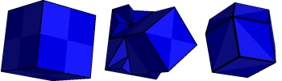
<figcaption>Figure: How to make a rhombic dodecahedron</figcaption>
</figure>

Don't create the dodecahedron by adding 4 pyramids to the 6 sides of the 1x1x1
sized cube. Why that doesn't work is explained below.

If you rotate the rhombic dodecahedron so that you can see only a square can be
seen and then remove 3 quarters of the square so that you get a square with
halve of the length you will get a six-sided centre block. 6 Pieces of this
block will nearly always be the centre of the puzzle. Other blocks will be
"glued" to the faces of those 6 six-sided centre blocks.

Cutting up the block further will result in the other blocks like the 2 prism
blocks, square octahedron, square pyramid, tetrahedral building block.

#### The shape dualism

Have a look at the image blow. You can see 2 connected identical shapes. They
are 2 diagonal star pieces. On the right image the voxels are also made
variable to make the inner structure of the shapes visible. What can be seen is
that both shapes do have the same outer appearance but a completely different
inner structure.

<figure id="FigShapeDualism">
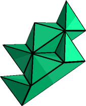
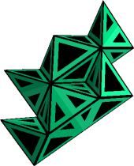
<figcaption>Figure: The shape dualism</figcaption>
</figure>

This can only result in problems and it sure does. All building blocks down to
the tetrahedral building block can be made in 2 different ways. BURRTOOLS will
not be able to match those 2 ways to build a shape. If you make a problem with
2 shapes that are made those 2 different ways and choose one to be the piece
and one to be the result you will get no solutions.

This all sounds like a severe problem but luckily it can be solved in a very
simple way by scaling all shapes up by 2. The program will then make sure that
all shapes are build the same way.

So keep in mind: When something doesn't work as expected or to make a final
check of the results scale up by two and check again.

### The Tetrahedral-Octahedral Grid

This grid is, just like the rhombic grid, a grid purely made out of tetrahedrons.
But here we have 2 different kind of of them. One regular and 4 irregular forming
together a cube. The 4 irregular tetrahedrons can be assembled into an octahedron.
They have one side with an equilateral triangle and 3 sides that are a diagonally
cut square. You can see one of those cubes in an exploded view in image
[Exploded Tetrahedral Octahedral view](#FigTetraOctaConstr). In that image you can
see the regular tetrahedron red in the middle and the other blue surrounding it.

<figure id="FigTetraOctaConstr">
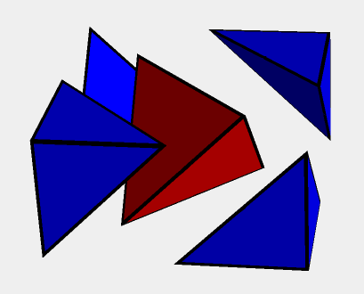
<figcaption>Figure: Exploded Tetrahedral Octahedral view</figcaption>
</figure>
<figure id="FigTetraOctaGrid">
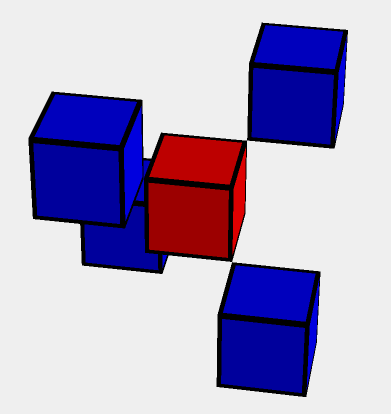
<figcaption>Figure: The grid representation of Tetrahedral Octahedral grid</figcaption>
</figure>

There are 2 ways to align the cube assembly of the regular and the 4 irregular
tetrahedrons in space. One is a rotation of the other. These 2 possible cubes
fill the space of this grid in a checkerboard pattern.

Internally this grid is, again just like the rhombic grid, represented by the
cube grid. Each cube in the tetra-octa grid uses a 3x3x3 cube in the cube grid.
The central regular tetrahedron occupies the central cube while the 4 irregular
cubes are placed in the diagonally opposite corners of the cube (see Figure
[Tetra-Octa Grid](#FigTetraOctaGrid)). In the image the red cube represents the
regular tetrahedron while the blue cubes represent the other parts.

And just like the rhombic grid this grid also has a problem that might require
upscaling in certain situations, so keep that in mind.

## Creating Shapes {#ChCreatingShapes}

The key concept of BURRTOOLS is *shapes*. A shape is simply a definition of
an object in 3-D space and consists of a collection of voxels (space units).
These voxels in turn may have their own characteristics such as *state* and
*colour*. Note that this definition also includes shapes made out of voxels
that are attached to each other by only a single edge, just a corner, or even
are completely separated in space. The solver certainly won't bother... but how
these shapes could be crafted in the workshop is beyond the scope of the
program.

All functions and tools for creating and editing shapes — once the grid type is
set — are located on the ***Entities*** tab which has — from top to bottom —
three main sections (Figure [EntitiesTab](#FigEntitiesTab)):

<figure id="FigEntitiesTab">
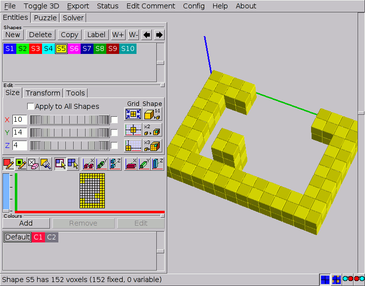
<figcaption>Figure: Creating shapes on the Entities tab</figcaption>
</figure>

**The *Shapes* panel**
:   This section is mainly a list of the available shapes and has the tools for
creating and managing the shapes. Shapes to be edited can be selected in this
list (→[CreatingShapes](#ChCreatingShapes)).

**The *Edit* panel**
:   This section provides the tools to build or edit the currently selected shape.
This panel contains a series of subtabs with several tools for adjusting the
***Size*** of the shapes, ***Transform*** them in 3-D space, and some extra
editing ***Tools***. Below these subtabs there's a toolbar with the devices for
actually constructing the shapes in the 2-D grid at the bottom of the panel
(→[BuildingShapes](#ChBuildingShapes)).

**The *Colours* panel**
:   This panel contains — besides a list of the available colours — the tools to
create and edit custom colours which can be assigned to the voxels of the
shapes. These colours can be merely ornamental or can have a serious impact on
the way the solver will work by imposing restrictions on the possible
placements of the pieces (→[Adding Colour](#ChAddingColour)).

## Creating Shapes

The very first step is to draw the shapes that can be used in your puzzle
design. All the tools to do so are just below the ***Shapes*** caption (Figure
[EntitiesTab](#FigEntitiesTab)). Clicking the ***New*** button starts a
completely new shape with an empty grid, while ***Copy*** allows you to edit a
previously entered shape without destroying the first. Obsolete and redundant
shapes can be discarded with the ***Delete*** button.

All shapes are identified with an '***S*x****' prefix. This prefix serves as
a unique identifier for the shape throughout the GUI and cannot be removed or
altered, but ***Label*** allows you to add a more meaningful name. Note that on
the status line the shapes will be referred to only by their prefixes.

By clicking an identifier in the list, the shape becomes selected and ready to
be edited. Also a short description of that shape appears on the status line.
The currently selected shape is indicated with a white border around its
identifier in the shapes list.

The buttons with the arrows pointing left and right allow you to change the
position of the shape in the list. The first one moves the selected shape
toward the front of the list, whereas the other button moves the shape toward
the end of the list. Note that rearranging shapes will cause their prefix to
change but not the additional name.

Unlike the pieces in PUZZLESOLVER3D, shapes don't need to be part of the
puzzle. This means that you can build a file that contains a vast number of
shapes, e.g. all 59 notchable six-piece burr pieces, of which you assign only 6
to the pieces of your puzzle design.

Finally, the shapes have an additional parameter: the weight. This value is
used when constructing the disassembly animations. When the disassembler has
found 2 groups of pieces that can be moved against each other it needs to
decide which group to actually move and which to keep where it is. This
decision can be influenced by the weight. The program searches the maximum
weight in both groups and the one group that has the bigger maximum weight will
be kept in place and the other group will be moved. If both groups have the
same maximum weight the group with the smaller number of pieces will be used.

Have a look at the chapter about
[optimizing the disassembly animation](#ChOptimizingDisasmSequences).

## Grid Functions

Since shapes are defined as objects in 3-D space, and theoretically 3-D space
is unlimited in size, it's convenient somehow to be able to define a more
feasible subspace to work with. This, and some more advanced scalings of the
shapes, can be accomplished with the functions on the ***Size*** subtab (Figure
[SizeSubtab](#FigSizeSubtab)) of the ***Edit*** panel.

<figure id="FigSizeSubtab">
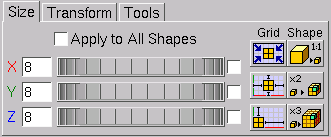
<figcaption>Figure: Grid and scaling functions</figcaption>
</figure>

Note that the tab might look slightly different for different gridtypes. For
example the sphere grid doesn't have the shape buttons as those are useless
with that grid.

### Adjusting the Grid Size

When the very first shape is initialised it has a default grid size. This
default size is different for each grid. For example it is 6x6x6 for cubes.
But if there is already a shape all other new shapes will inherit the grid size
of the currently selected shape. This feature can be very useful in creating a
series of shapes that are restricted with respect to certain dimensions (e.g.
all pentacubes that fit in a 3x3x3 grid). Selecting the proper shape before
creating a new one often can save a considerable amount of time by avoiding
grid adjustments.

Adjusting the grid size to your needs can be done either by entering values in
the input boxes next to the axis labels, or by dragging the spin wheels. When
you enter values, the grid will be updated as soon as you select one of the
other input boxes (either by a mouse click or by the `[Tab]` key), or when
you press the `[Return]` key. Note that the grid is also updated by simply
clicking in or next to the 2-D grid. To avoid unexpected results it's
recommended always to confirm the entered values with the `[Return]` key.
Increasing any grid dimension is completely harmless, but decreasing them needs
some caution since it can destroy parts of the shape.

The checkboxes for *linking adjustments* — to the right of the spin wheels
— allow you to adjust two or all dimensions simultaneously. All linked
dimensions will increase or decrease by the same *absolute* amount. However,
none of the dimensions can be made smaller than 1 unit. Linked dimensioning is
very useful in creating bigger and complex shapes such as the result shape of
NO NUKES!  (Ronald Kint-Bruynseels), which is easily done by first creating the
central burr in a 6x6x6 grid and adding the extensions after resizing the grid
to 14x14x14 and centring the 'core' in that enlarged grid.

### Advanced Grid and Scaling Functions

BURRTOOLS has some powerful time-saving functions to manipulate the position of
the shape in its grid or to rescale a shape together with the grid. These
features are grouped below the captions ***Grid*** and ***Shape*** on the right
side of the *Size* subtab. The first set of three will affect only the grid
and/or the position of the shape in the grid, the other procedures however will
have an impact on the shape itself by scaling it up or down.

Below is an overview of these functions, explaining precisely what they do and
with an indication of the reason they were introduced into BURRTOOLS. No doubt
you'll soon find other situations in which these tools can prove to be
valuable.

***Grid* tools.** Most of these tools are somewhat extended versions of the
more general transformation tools (→[TransformationTool](#ChTransformationTools))
and have the advantage that they can act on all shapes at once
(→[AdjustAllShapes](#ChAdjustAllShapes)).

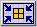:
:   **Minimise the grid -** This function will minimise the grid to fit the
dimensions of the shape it contains. Use it to reduce the disk space occupied
by your puzzle files. Note that the result of this function is strictly based
on the contents of the grid and will have no effect whatsoever on empty grids.

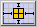:
:   **Centre the shape in the grid -** This function centres the shape in the
surrounding grid thus allowing you to edit all sides of the shape. In some
cases this will also *increase* one or more dimensions of the grid by a single
unit to provide true centring. The function is most useful in editing
symmetrical shapes in combination with the compound drawing methods
(→[CompoundDrawing](#ChCompoundDrawing)).

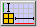:
:   **Align the shape to the origin -** This function brings the shape as close as
possible to the origin of the grid. It can very useful if you want to make a
descending series of rectangular blocks by copying the shape and manually
adjusting the grid dimensions.

***Shape* tools.** Use the following functions wisely because unnecessary
and extreme scaling up of the shapes will put a heavy load on your system
resources and can increase solving time dramatically. Also, trying to undo such
'ridiculous' upscalings with the 1:1 tool can take a long time.
So, *think twice, click once...*

These tools make sense only for spacegrids where a group of voxels can be
grouped to make an upscaled shape that looks like a voxel of the grid, e.g. a
group of 2x2x2 cubes looks like a bigger cube. As this doesn't work with
spheres, these tools are not available there.

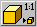:
:   **Minimise the size of the shape (1:1 tool) -** This function tries to make the
shape as small as possible without any loss of information and at the same time
scales down the grid by the same factor. Use this function to check the design
for oversized shapes which would slow down the solver. Note that although this
function can undo the effects of both of the next scaling functions, the result
cannot be guaranteed since the algorithm may scale down beyond the initial
size.

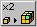:
:   **Double the scale -** This function will double the scale of the shape (and
its grid). In other words, it will replace every voxel in the shape with a
group of voxels that all have the same characteristics (state and colour) as
the original voxel. This can be very useful to introduce half-unit notches or
colouring into the design without having to redraw the shape(s).

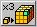:
:   **Triple the scale -** This function is similar to doubling the scale, only now
a scaling factor of 3 is used and hence every voxel in the shape will be
replaced by 27 identical voxels. This can be very useful if you want to
introduce *'pins and holes'* into your design.

### Adjusting All Shapes {#ChAdjustAllShapes}

A last, but certainly not least, item to mention is the ***Apply to All Shapes***
checkbox. When checked, *all* shapes — whether they are selected
or not — will be affected by the settings and procedures on the ***Size***
subtab. This is very useful and time saving when a certain adaptation needs to
be done to all the shapes, e.g. transforming a six-piece burr with length 6
into one with length 8.

However, some precautions are built in to prevent accidental destruction of
shapes. Manually reducing any grid dimension will still be performed only on
the currently selected shape, whereas increasing (which is completely harmless
to the shapes) will affect all grids. On the other hand, minimising the grids
will be applied to all shapes since it is content related. The 1:1 tool won't
affect any shape unless *all* shapes can be scaled down
*by the same factor*. This prevents ending up with an unintended
mixture of differently scaled shapes.

## Building and Editing Shapes {#ChBuildingShapes}

Once a shape has been initialised, the 2-D grid in which it can be built
becomes accessible on the ***Edit*** panel. Basically one needs only three
tools to create any shape, but some more features are added to make life easy.
All these are on the toolbar right above the 2-D grid (Figure
[FigureToolbarGrid](#FigToolbarGrid)). The first four buttons are the
*basic drawing tools* and *colouring tool*. These are all toggle buttons,
meaning that enabling one will disable the others. They affect the presence
and/or the state and colour of the voxels drawn by clicking in or dragging over
the cells in the 2-D grid.

<figure id="FigToolbarGrid">
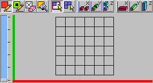
<figcaption>Figure: Toolbar and 2-D grid für cube space-grid</figcaption>
</figure>

Next come two toggle buttons that allow you to select the *drawing style*.
This is the way the basic drawing tools will respond to dragging the mouse over
the grid cells. Finally, a series of *compound drawing tools* follows. These
extend the range of the basic drawing tools and can all be cumulatively added
to them.

Keep in mind that the grid looks differently for each space-grid. And for some
spacegrids this 2-D grid is meant mainly for information as editing sphere shapes
with the 2-D grid can be troublesome and with the rhombic grid is close
impossible to properly edit a shape with the 2-D grid. That is why all shapes
can be directly edited within the 3-D viewer. But nevertheless, the 2-D grid
has its merits.

### Navigating in 2-D and 3-D {#ChNavigating}

Building and editing can take place exclusively in the 2-D grid, and then the
3-D viewport acts only as a visual aid. Both have their corresponding axes in
the same colour: *red* for the x-axis, *green* for the y-axis and *blue*
for the z-axis. For the 2-D grid, which actually can show only a single layer
at a time, the z-axis is represented with a scrollbar (Figure
[FigureToolbarGrid](#FigToolbarGrid)). By default every new shape starts on the
bottom layer and the scrollbar allows you to move up and down through the
different layers along the z-axis (the number of z-layers is always indicated
with the proper number of ticks along the scrollbar). Another way to navigate
these z-layers is by pressing `[+]` (moves up one layer) or `[-]` (moves
down one layer) on the keyboard.

<figure id="FigNavigation">
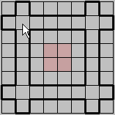
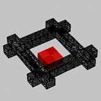
<figcaption>Figure: Selections of grid cells in 2-D and 3-D</figcaption>
</figure>

Moving the mouse cursor over the 2-D grid gives an indication of the cell(s)
— depending on the state of the compound drawing tools — that will be
affected by clicking. These indications are also reflected in the 3-D viewer.
Furthermore, to facilitate positioning on different layers every non-empty
voxel on the 2-D layer just below the current one 'shines through' in a very
light shade of the default colour associated with that shape (Figure
[FigureNavigation](#FigNavigation)). This makes building shapes from bottom to
top very easy.

With larger grid sizes the cells of the 2-D grid can become very small, even
when the available area for the grid on the *Entities* tab is maximised. To
overcome this inconvenience the 2-D grid and the 3-D viewport can be exchanged.
To do so, click the ***Toggle 3D*** item on the menu bar or press `[F4]`.
Note that this affects only the position of the 3-D viewport for the
*Entities* tab.

### Basic Drawing Tools

The basic drawing tools affect the presence and/or the state of a particular
voxel in the shape. In fact, together with the brush tool (→[Brush Tool](#ChApplyingColours))
they are all that's needed to create any shape in BURRTOOLS. The
following is a description of these tools. Note that each is also accessible
through a keyboard short cut.

:
:   **Fixed pen -** Use this tool to draw *normal* or *fixed* voxels. Fixed
voxels are represented by completely filled cells in both the 2-D and the 3-D
grid (→[Representation](#ChRepresentations)). Remember that these fixed voxels
*must be filled* in the final result. Keyboard short cut: `[F5]`.

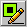:
:   **Variable pen -** This tool allows you to draw *variable* voxels. In the 2-D
grid these variable voxels do not completely fill the cells, but have a narrow
border showing the background of the grid. In the 3-D viewport the variable
voxels have a black inset (→[Representation](#ChRepresentations)). Variable
voxels instruct the solver that these particular places may be *either*
*filled or empty* in the final result. So variable voxels are allowed only in
result shapes, and the solver will give a warning whenever it encounters any
variable voxels in a shape used as a piece. Short cut: `[F6]`.

:
:   **Eraser -** The eraser will remove voxels from the shape. Note that clicking
or dragging with the right mouse button has the same effect of erasing voxels.
The eraser tool however proves its use in minute adaptations of shapes. Short
cut: `[F7]`.

### Drawing Styles

BURRTOOLS has two different drawing styles. These styles affect the way voxels
are drawn/erased or colours are added by *dragging* with the mouse. In
drawing shapes by simply clicking 'cell-by-cell' both are equivalent.

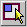:
:   **Rectangular dragging style ('rubber band') -** On dragging over the 2-D grid
with the mouse, a *rectangular selection* of cells will be made. This is
shown with a heavy border around the selected cells and the voxels will only be
altered on releasing the mouse button. But releasing the mouse button outside
the actual grid will make the whole operation void and can serve as a sort of
'undo'. This style is useful not only for drawing rectangular shapes or parts,
but also for adding colour to (large areas of) the shape.

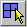:
:   **Free dragging style -** All drawing and colouring operations will be
performed on a single cell basis and *as soon as* the mouse cursor is dragged
over that particular cell. This drawing style is very useful for creating
complex and irregular shapes and colour patterns.

The status of these drawing styles is remembered by BURRTOOLS so that it always
defaults to the drawing style that was active on the last shut down of the
program.

### Compound Drawing Tools {#ChCompoundDrawing}

Although the basic drawing tools are all that is needed for creating shapes,
some compound drawing tools are added to speed up the process. The compound
drawing tools can be added *cumulatively* to the basic drawing tools and only
extend the range of action for the latter ones.

Note that these tools always function along the 3 orthogonal axes, so they are
very useful for cubes but might need a bit of getting used to for the other
spaces as they might behave differently along the 3 axes. The triangular prisms
for example are stacked along the z-axis, side by side along the x-axis and tip
by tip along the y-axis.

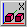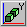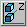:
:   **Symmetrical drawing methods -** For every voxel drawn, erased, or coloured
its symmetrically placed counterpart (with respect to the centre of the grid
and along one of the space axes) will be affected as well. Activating only one
of these options will double the number of edited cells, whereas activating two
or all three will affect respectively four times and eight times as many cells
simultaneously. These options are not only useful for drawing symmetrical
shapes, but they are also very well suited for finding the centre of the grid
and (temporarily) setting the extents of a shape.

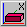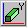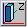:
:   **Column drawing methods -** These options — possibly combined with the
symmetrical drawing tools — can really speed up drawing shapes as they will
affect *all* voxels that are in the same row or column along one of the space
axes. The number of voxels that will be affected depends on the size settings
of the grid. Hence, to take fully advantage of these functions the grid should
be first adjusted to the proper dimensions.

### Using the 3D-Viewer to Edit

As editing non rectangular shape with the 2-D grid is cumbersome, it is also
possible to do some editing using the 3-D view directly by simply clicking onto
faces to add the corresponding neighbour voxel. This will always only add or
remove single voxels and will not honor the compound drawing settings.  The
following actions are possible:

- Add a normal voxel by pressing `[Shift]` and clicking onto a face. The
  neighbour is added.
- Add a variable voxel by pressing `[Alt]` and clicking onto a face. Again
  the neighbour is added.
- Remove a voxel by pressing `[Ctrl]` and clicking onto a voxel. This removes
  the voxel.

As spheres do not really have touching faces the 3-D view of them does contain
circles with a slightly different colour around the places where the spheres
would tough. Clicking on those circles on the sphere adds the corresponding
neighbour sphere.

To avoid having to click all that often you can wiggle the mouse around to get
a repeated action. So if you want to "drill" a hole into a shape place your
mouse there, click and drag over the hole and the voxels will be gone much
faster than with repeated clicking.

## Adding Colour {#ChAddingColour}

There are basically two reasons for using colours in your puzzle designs. The
first is merely *aesthetic*: colours are used only to explore the looks of
the puzzle. This can help you selecting the proper species of woods or stains
before taking your design to the workshop. The second however is far more
important, as it uses colours to force or prevent certain positions of
particular pieces in the assembly. These *constraining* techniques can be
very useful to pursue a unique solution for a puzzle design. Of course one can
try to achieve both the aesthetic and constraining goals at the same time.
Figure [FigureCustomColours](#FigCustomColours) shows an example of DRACULA'S
DENTAL DISASTER (Ronald Kint-Bruynseels) in which colours serve both. The red
and black voxels are meant to impose constraints on the placements of the
pieces, whereas the white colour of the parts on the inside of the pieces is
used only to make them look nice.

<figure id="FigCustomColours">
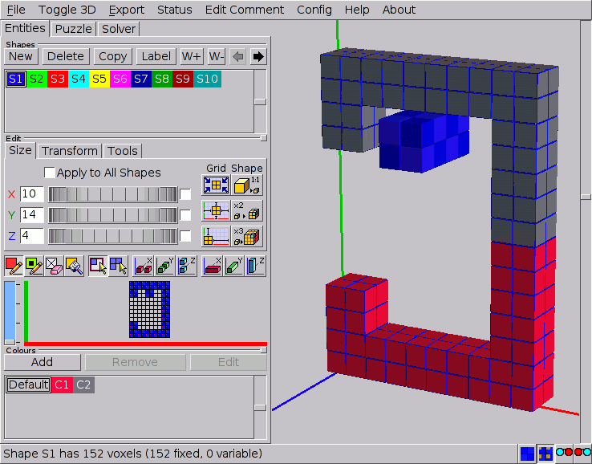
<figcaption>Figure: A shape with custom colours</figcaption>
</figure>

### The Default Colour and Custom Colours

Even when no 'special' colours at all are used, the program assigns each shape
its own different nominal colour. This is the so-called *default colour* and
is there only to *distinguish* the shapes from one another. These default
colours are standard for each newly created shape (the first one in the shapes
list is always blue, the second one green, the third one red, etc...) and
cannot be altered.

As far as the solver is concerned, the default colour doesn't even exist, as
all appearances of it are fully interchangeable. So any voxel in the pieces
that has only the default colour can go into any voxel of the result shape, and
every voxel in the result that has no other colour than the default can
accommodate any voxel of the pieces, independent of its colour.

Independent from their default colour, voxels can have customised colours as
extra attributes. To avoid confusion, it's recommended to make these colours
well distinguishable from the default colours in use, since a custom colour
that is identical to one of the default colours will have a completely
different effect on the way the solver behaves. Almost without exception custom
colours need some constraint settings (→[ColourConstraints](#ChColourConstraints))
to make the solver run.

### Creating and Editing Custom Colours

The tools for creating and editing colours are located on the ***Colours***
panel of the ***Entities*** tab. This panel also has a list in which the
colours can be selected to be used in the design or to be edited. The ***New***
button allows you to create a custom colour. A dialogue will pop up and present
you the necessary tools to create the colour you need. Accordingly the
***Edit*** button allows you to transform an already existing colour using a
similar dialogue. This dialogue also shows the currently selected colour for
comparison (unless the default colour is selected, which makes the dialogue to
show the default medium grey). Note that the default colour can be neither
removed nor changed. It's important to realise that the BURRTOOLS engine
discriminates custom colours only by number as indicated in their prefix
'***C*x****' and not by the actual colours themselves. Hence it is possible
to create identical colours that nevertheless will be treated as different. So,
it's strongly advised to introduce only colours whose difference can easily be
discerned. Otherwise, finding out why a puzzle has no solutions can be very
hard. The ***Remove*** button will not only discard the colour from the list,
but will also remove it from any voxel that has it as an attribute by replacing
it with the default colour.

When you add a colour, BURRTOOLS automatically adds a constraint rule that
pieces of this colour can be placed into result voxels of this colour. This is
done by default because it is the way colours are most often used. If you don't
want this constraint you have to explicitly remove the rules
(→[ColourConstraints](#ChColourConstraints)). Also, when a new problem
is created BURRTOOLS automatically adds one such rule for each existing colour.

### Applying Colours {#ChApplyingColours}

Colours can be applied while drawing the shape. Just select a colour and it
will become an extra attribute of the fixed pen or the variable pen.
Additional colouring can be done by using the *Brush* tool.

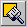:
:   **Brush tool -** This is a *'colouring only'* device and merely adds the
selected colour to the voxels without altering their state. The brush tool can
also be activated by pressing `[F8]` on the keyboard.

The behaviour of this brush tool is similar to that of the drawing pens. So it
obeys the drag styles and can be extended with the compound drawing tools. Note
that the right mouse button will still completely erase the voxel.

## Representations {#ChRepresentations}

Voxels can be either fixed or variable, and each of these can come with or
without an additional custom colour. In BURRTOOLS all of these cases have their
own specific representations in the 2-D grid as well as in the 3-D viewport.
Figure [Representation](#FigRepresentations) shows an overview of these
possibilities. In this picture the default colour is red (= shape S3) and the
custom colour is yellow (RGB = 1, 1, 0).

<figure id="FigRepresentations">
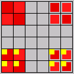
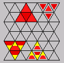
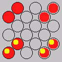
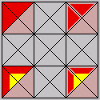
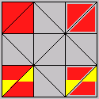
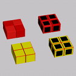
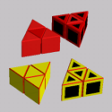
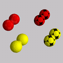
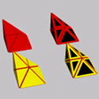
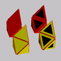
<figcaption>Figure: Representations in 2-D and 3-D</figcaption>
</figure>

Fixed voxels always fill the cell completely in the 2-D grid as well as in the
3-D grid. In all the pictures of Figure [Representation](#FigRepresentations)
the voxels on the left are fixed voxels. Variable voxels only partially fill
the cell in 2-D and have a black inset in 3-D (the voxels on the right in
Figure [Representation](#FigRepresentations)). For spheres the insed is simply
a part of the surface.

Voxels that have a custom colour added (the yellow voxels in Figure
[Representation](#FigRepresentations)) show this colour as an inset in the
2-D grid, whereas in the 3-D viewer they are completely painted with this
colour (provided that the ***Colour 3D View*** on the status line is checked,
otherwise they will be painted in the default colour). Note that in both grids
the default colours also have a slightly checkered pattern which can assist
navigating in space (except for the spheres, which have no checkering).

## Transformation Tools {#ChTransformationTools}

Editing complex shapes can be very cumbersome and often requires a lot of
navigating through the 2-D grid. So, properly positioning and/or orientating
the shape in the 2-D grid can save a lot of time. BURRTOOLS comes with a set
of functions that help you adjust the position and orientation of the shapes.
These functions are grouped on the ***Transform*** subtab of the ***Edit***
panel (Figure [TransformationTools](#FigTransformationTools)). The first
thing to see is that the transform tab looks quite different for all 3
available gridtypes. At the top of the figure you see the tab for cubes, below
for triangles, and at the bottom for spheres.

<figure id="FigTransformationTools">
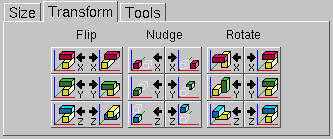
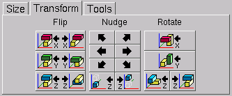
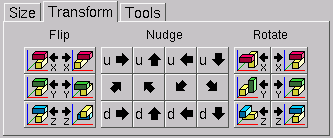
<figcaption>Figure: Transformation tools</figcaption>
</figure>

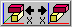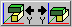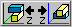:
:   **Flip -** These 'three' functions are merely *one single mirroring tool*,
the only difference is the orientation of the mirrored shape they provide. The
first will mirror the shape along the x-axis (or in a plane through the centre
of the grid and parallel to the YZ-plane). The others perform the same task,
but along the y-axis (XZ-plane) or the z-axis (XY-plane) respectively. Note
that each button can undo its own action as well as the actions of the other
buttons, since the result of each function can be obtained by simply rotating
the outcome of any other. However, there are three buttons to provide some
control over the orientation of the mirrored shape in the grid space, which can
save time if the shape needs further editing.

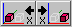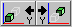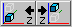 and more:
:   **Nudge -**These functions provide *translations* (along the x-axis, y-axis
or z-axis for the cubes, or along different axes for other gridtypes) of the
shapes in their surrounding grids. These buttons have two parts, of which the
left part will shift the shape towards the origin of the grid and the right
part will move it away from the origin. Note that shifting a shape beyond the
boundaries of the grid will (partially) destroy it. So these nudging operations
can also be used to erase unwanted parts on the outer limits of the shapes.

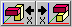:
:   **Rotate -** These functions allow you to *rotate* the shapes around an axis
parallel to the x-axis, y-axis or the z-axis. Again, these buttons have two
parts, of which the left rotates the shape 90° anti-clockwise (viewed towards
the origin) and the right button turns the shape 90° clockwise. To avoid
destroying shapes by rotating them, the grid may be rotated as well.

The triangle space has only one rotation button for the x and y-axis because it
is possible to rotate only by 180° around these axes.

## Miscellaneous Editing Tools

The ***Tools*** subtab (Figure [Tools](#FigTools)) offers extra editing
tools. Currently only some constraint related tools are available.

<figure id="FigTools">

<figcaption>Figure: Extra editing tools</figcaption>
</figure>

### Constraining Tools {#ChConstrainingTools}

These tools are *mass editing* tools that have an impact on the possible
placements of the pieces in the final result. They act either on the inside or
the outside of the shape. Voxels that are considered to be on the inside are
voxels that have another voxel adjacent to *all* of their *faces*.
Consequently, outside voxels have at least one empty voxel neighbouring.

:
:   **Fixed Inside/Outside -** These functions allow you to change the state of the
voxels that are either on the inside (left button) or on the outside (right
button) of the shape into fixed voxels. Although one can think of situations in
which these can be useful as such, they are mostly used to undo the effects of
the next two functions.

:
:   **Variable Inside/Outside -** These functions will respectively make all the
voxels on the inside or the outside of the shape variable. Making the inside
variable is very useful for puzzles with internal holes in undetermined places.
On the other hand making the outside variable can be helpful in a lot of design
situations (e.g. adding extensions to the pieces). Clicking both buttons will
make the shape completely built out of variable voxels. Use these wisely as the
more variable voxels there are, the slower the solver will run.

:
:   **Colour Remover -** These buttons will remove any custom colours from the
voxels that are either on the inside or the outside of the shape, and replace
them with the default colour. Removing the colour from the inside can prevent
having to apply complex colouring to the result shape in situations were the
colour constraints are relevant only to the overall appearance of the puzzle.

Depending on the grid the tab might contain more buttons with more actions.
Right now the following additional tools are available

Fill Holes
:   This button will fill all internal, which means completely surrounded, voxels
of the selected shape. This is useful for more complex grids, where is is not
easy to see in the grid view whether a voxel is on the inside or not.

## Converting Shapes {#ChConvert}

For some grid types it is possible to convert the shapes of a puzzle from one
grid type to another. That means the base grid type of the puzzle is exchanged,
the solutions are deleted and the shapes are replaced.

Currently the following conversions are implemented:

- cube grid to rhombic grid
- cube grid to tetra-octa grid

To do one of those conversations choose ***File - Convert***. A Window will
pop up showing you to what other grids you can convert the current puzzle. If
no grids are available a message will display this information.

You then choose your intended target grid and confirm. That's it. Useful is
this if you need big shapes in the rhombic grid that would be a lot of work to
assemble manually in those grids. On the other hand: this tool requires a bit
of planning ahead because you first need to create the prototype shapes out of
cubes then convert and then perform the final modifications.

## Importing Assemblies as Shapes {#ChImportAssms}

With this tool it is possible to create shapes out of a set of assemblies of
one problem of your puzzle.

When you choose this option a window will pop up, which looks a bit like the
window in Figure [Assembly Import](#FigAssmImportWindow). A few of the options
are not available in all grids and might be missing in your actual window.

<figure id="FigAssmImportWindow">

<figcaption>Figure: The assembly import window</figcaption>
</figure>

The Window contain the source problem in the top. All assemblies of this
problem are taken and converted into shapes.

Below you can select, if you want those new shapes added to a new problem,
to an existing problem, or to no problem at all.

If you want to add the new shapes to an existing problem you can choose to
which one

If you add the shapes to a new or existing problem you can define the range
that the pieces get in the problem.

Finally you can filter the shapes using several filters. All the conditions
of the selected filter must be fulfilled at the same time. The filter
conditions are connected with a logical *and*.

The following filter conditions are available:

Drop disconnected shapes
:   Shapes where you have 2 or more voxelgroups that are not face-connected with
one another fill be dropped

Drop shapes with mirror symmetry
:   Shapes that have a mirror symmetry, that means shapes that can be flipped over
and still look identical are dropped

Drop all shapes with a symmetry
:   Only completely non symmetric pieces are kept

Drop non millable shapes
:   Only pieces that contain no inside corners are kept. This option is only
available on the cube grid

Drop non notchable shapes
:   Only shapes that can be made with a saw are kept. This option is only available
on the cube grid

Drop identical shapes
:   Only import shapes that are different from one another. It might be that the
same shape can be build in different ways with the building blocks you defined.
If you don't want those identical looking shapes check this box.

Range
:   You can choose a range out of how many voxels the shape must consist. If the
new shape contains more or less voxels it will be dropped and not get added to
the puzzle

See chapter [piece generation](#ChPieceGeneration) for a usage example of this
feature.

## Managing Shapes and Colours

Currently the shapes can only be rearranged with the left and right arrow
buttons of the *Shapes* section.

## Shape Information {#ChStatus}

When using the main menu entry ***Status*** a window (Figure
[WindowStatus](#FigWindowStatus)) like the one above opens and displays all kinds
of information about all the shapes available inside the puzzle. The table
columns have the following meanings:

<figure id="FigWindowStatus">

<figcaption>Figure: The Status window</figcaption>
</figure>

Units Normal
:   Contains the number of voxels inside the shape that have the state fixed.

Units Variable
:   Contains the number of voxel inside the shape that have the state variable.

Units Total
:   Contains the number of voxels inside the shape that are either fixed or
variable.

Identical
:   If the shape is identical to another shape with smaller number, the first such
number is displayed; so if shape 3, 4, and 5 are identical, shape 4 and 5 will
point to shape 3 but shape 3 will show no indication.

Identical Mirror
:   A previous shape is cited, if the shapes can somehow be transformed into the
other including the mirror transformation.

Identical Shape
:   A previous shape is cited, if the shapes are identical without mirroring.

Identical Complete
:   In this case shapes must be completely identical including colours and not only
the appearance of the shape.

Connectivity
:   This part of the table shows if the shape is completely connected, i.e. doesn't
contain any separate voxels.

Connectivity Face
:   This part is marked with an X when all parts of the shape are connected via the
faces of the voxels. A face is a surface of a voxel. Cubes have 6 such faces,
the triangular voxels have 5, and spheres have 12 faces.

Connectivity Edge
:   This part is marked with an X when all parts of the shape are connected via an
edge or a face of the voxel. An edge is the connection between 2 corners of a
voxel. A cube has 12 edges and the triangular voxel have 9. Spheres have no
edges.

Connectivity Corner
:   This part is marked with an X when all parts of the shape are connected via a
corner, an edge, or a face. A corner is the end of an edge. Cubes have 8
corners, the triangular voxel have 6 corners, and spheres have none.

Holes
:   This part of the table contains information about possible holes inside the
shapes.

Holes 2D
:   A 2D hole is a hole in a 2-dimensional shape. So the o-octomino has a 2D hole.

Holes 3D
:   A 3D hole is a completely surrounded region inside a shape.

Sym
:   This is a column that is mainly there for my help. BURRTOOLS needs to know
about all kinds of symmetries a shape can have. If a shape turns up that has a
kind of symmetry yet unknown to the program it cannot solve puzzles with this
shape. So here is a tool to check beforehand and without the need to create a
problem. If you ever see a coloured mark in the last column send me the shapes
where it turns up. As long as this last column contains only numbers without a
coloured mark everything is fine.

Because calculating all this information can take a considerable amount of
time, BURRTOOLS pops up a window when it is working on accumulating this table.
The window contains a progress bar to guess how much longer it will take. There
is also a *Cancel* button at the bottom that lets you abort this
calculation and view the results already gathered.

## Tips and Tricks

Below are some tips and tricks that can be useful to simplify your designs,
speed up the designing and/or solving process, or can be used as workarounds
for some limitations of BURRTOOLS. We encourage the reader to share his own
tips and tricks with us so that we can incorporate them in a future update of
this document.

### Voxel State and Size Tips

**State and Solver Speed**
:   The greater the proportion of variable voxels in the result shape, the slower
the solver will run. Also, the number of pieces has an impact on the solving
time. Hence, replacing variable voxels with empty spaces for known holes in the
puzzle is to be considered. Also, leaving out a piece in complex packing
puzzles (and making its position empty in the result) can reduce the solving
time considerably.

**Size and Solver Speed**
:   The size of the shapes has an effect on the solving speed, since bigger shapes
inevitably lead to more possibilities: for a 1x1x1 cube there's only one
possible placement in a 2x2x2 grid (excluding symmetries), but for a 2x2x2 cube
there are four of them in a 4x4x4 grid. So trying to minimise *all* shapes
with the 1:1 tool before taking the puzzle to the solver is highly recommended
for complex designs.

**Complete sets**
:   Often complete sets of pieces (e.g. the hexacubes in HAUBRICH'S CUBE) can be
easily made by repeatedly copying the current shape and editing it with the
properties of left and right clicking.

**Symmetry**
:   A detailed treatment of some symmetry issues will be added to the next update
of this document.

### Colouring Tips

**Colouring Shapes**
:   Colouring shapes as a whole is easily done with the brush tool in combination
with the rectangle dragging style and z-columns switched on.

**Aesthetic Colours**
:   When colours are used solely for aesthetic reasons, make sure that the
*result* shape has only the default colour. This will prevent having to set a
lot of constraint conditions.

**One-Sided Polyominoes**
:   Polyominoes can be made one-sided by having them two layers thick and adding
different constraint colours to the two layers. The constraint settings
(→[ColourConstraints](#ChColourConstraints)) should simply be a
'one-to-one' relationship.

**Hiding Pieces**
:   For puzzles in which the goal is to hide a certain piece on the inside of the
assembly (e.g. Trevor Wood's WOODWORM), *two* constraint colours should be
used in the result shape: one for the exterior and one for the voxels on the
inside and one for those on the outside. Also colour the piece that must be
hidden with the 'inside' colour, and apply the 'outside' colour to all other
pieces. The constraint settings (→[ColourConstraints](#ChColourConstraints))
must then be such that the piece to be hidden is allowed to go only into the
'inside' colour, while the other pieces may go into either colour.

**Marks On Shapes**
:   Colours can also be helpful to give orientation on pieces. When trying to add
additional voxels to a given shape add them with a new constraint colour.  This
way you will easily find it again. Once everything is done remove the colour
from the colour list and the marks will be gone as well.

Also having marks on the pieces will ease orientation between the transformed
piece in the solution and the original piece in the piece editor.

Finally marks will help other people understanding how pieces are made. If you
generate pieces by merging 2 shapes you could colourize one shape so that other
people quickly see the construction rule (see the Broken Sticks puzzle in the
[examples](#ChExamples)).

## Piece Generation {#ChPieceGeneration}

Sometimes you want to use a complete mathematical set of pieces for designing a
puzzle or for analysing one. Creating such a complete set is and tedious and
error prone process.

BURRTOOLS provides tools that may in many cases do a lot of the work you need.
The tools themselves are explained in their appropriate places here we will
just do an example so that you can see how they do fit together.

To make things easier an example file is provided:
`DemoPieceGenerator.xmpuzzle` if you load this file you will find some of the
below actions prepared for you.

For this example we set us the following task:

Find all notchable 6-piece-burr pieces.

To do that let's start by adding the minimal shape for a 6-piece-burr piece and
a single cube.

Now we also need a shape that defines what expanse the final shape can have. This
is a simple 2x2x6 block in our case. Within this block mark all cubes of the
minimal bur-shape as filled and the rest as variable.

Now define a problem. Add the basic 6-piece-burr shape. We also need to add
single cubes. As we want all shapes starting from 0 cubes added up to the
complete block we need to have 0-10 of those single cubes, so set the range for
the single cube to 0-10.

Now we have all that we need. All this is prepared in the provided file.

Go ahead and solve this problem. Here you should tag the *Expensive rot. check*
check-box (→ [Rotation considerations](#ChRotationRemoval2)) and also
the *Keep Mirror Solutions* check-box. Set the limit high enough to keep
all solutions (there will be 1024 solutions).

Now solve, you will get 1024 solutions. To import those solutions into a problem
(→[Assembly import](#ChImportAssms)). Use File - *Import Assms*. In the
dialogue that pops up select the problem P1 as source for the import and as
destination for the new shapes choose to add them to a new problem. Also tag
the *Filter disconnected pieces* and the *Drop non notchable* check-box.
We end up with a new problem P2 with 52 pieces.

That's it you can now work with this set of pieces and find your own favourite
6-piece burr.

A few remarks to this explanation:

- The result shape of the problem defines the maximum possible expanse of the
  final shapes you generate, so if you wan all pentominoes that fit into
  an 3x3x3 cube just define a 3x3x3 cube as result shape
- This method is not really suitable for really huge numbers of shapes (e.g.
  creating all octominoes) because you first need to generate all possible
  arrangements of cubes, which is much much more than the already big number
  of octominos. Here a filter is required that already filters assemblies,
  but that is a future project.
- The *Keep Mirror Solution* tag is required as otherwise you'd end up
  with only one shape out of mirror pairs.
- The default settings for the assembly import filter is normally good, except
  if you need special constraints
- Be careful, as the import can't be undone and removing a huge pile of shapes
  can be a tedious job, so better save before doing an import

## Simulating non-cubic spacegrids

It is possible to emulate spacegrids different from cubes by just using cubes.
This way BURRTOOLS can solve different kind of puzzles. This section will give
hints on how to such things. It will not contain obvious emulation
possibilities like hexagons with 6 triangles or x by y rectangles using several
squares, but rather some of the more complicated possibilities. The chapter
cannot be complete but rather it wants to suggest what can be done and give you
some initial ideas. If you come up with a cool idea you are welcome to send it
to me and I will include it here.

Generally this emulation requires using N cubes for one basic unit. This will
probably result in a slowdown of the solving process, but the slowdown is not
always that grave. BURRTOOLS knows how to merge voxels that are always occupied
by the same piece into one, so if there is for example a puzzle that uses
hexagonal pieces made out of the triangular prisms and these hexagons are
always aligned on a hexagonal grid, BURRTOOLS will merge the 6 triangles
together and work with the resulting shapes. This takes some time only at the
initialisation phase. On the other hand, there might be many placements of
pieces that fit the underlying cube to triangle grid that are not proper
placements and that need to be sorted out first. This can take a long time.
MAJOR CHAOS by Kevin Holmes for example has a lot of illegal placements for
pieces that need to be sorted out. That takes a very long time, but once that
is done the solving is actually very fast.

### Two-Sided Pieces

If you have pieces that have a top and a bottom, there are several
possibilities to model that in BURRTOOLS. One possibility is to use colours.
Make the piece and the result 2 layers thick. The bottom layer of both will get
a special colour.

Another possibility is to add an additional layer that has voxels only in
certain places as seen in the picture. The additional voxel prevents the
rotation of the shape. But you have to make sure that the allowed rotations are
still possible, e.g. if you place the notches in different places rotation
around the z-axis is also no longer possible. An example can be seen in Figure
[Emul2Sided](#FigEmul2Sided)

<figure id="FigEmul2Sided">

<figcaption>Figure: Emulation of 2-sided pieces</figcaption>
</figure>

### Diagonally Cut Cubes and Squares

Cubes can be cut in many different ways, to approximate shapes such as given in
Figure [EmulDiagCut](#FigEmulDiagCut) use the 2x2x2 cube displayed there.

<figure id="FigEmulDiagCut">

<figcaption>Figure: Diagonally cut cube</figcaption>
</figure>

It is, of course, also possible to simulate diagonally cut squares this way.
The squares need to be 2 layers thick.

BURRTOOLS can also handle half cubes with the Rhombic Grid. But that is more
expensive because you need 24 units for a whole cubes while this emulation only
needs 8 units for one cube.

### Cairos

Cairos are pentagons but luckily they have only 4 rotations, so it is possible
to emulate them using squares. Figure [EmulCairos](#FigEmulCairos) demonstrates how
that can be done.

<figure id="FigEmulCairos">

<figcaption>Figure: Emulation of Cairos using squares</figcaption>
</figure>

### Squares with Cuts of Slope 0.5

TBD

### Edge Matching

Sometimes it is possible to emulate edge matching problems by using notches and
dents at the outside of the shapes.

<figure id="FigEmulEdgeMatching">

<figcaption>Figure: Emulation edge matching cubes</figcaption>
</figure>

As example let us have a look at a puzzle designed by Marcel Gillen: "Octopuz".
This puzzle has pieces that are made out of 2 quatrominos. Those 2 quatrominos
are connected to each other with a link and they can be turned so that in the
end each piece has 4 possible shapes depending on how you rotate one halve
against the other.

These shapes can be modelled using edge matching simply taking the shapes apart
into their 2 halves, and colourize the touching surfaces of she 2 shapes of one
piece with the same colour and a different colour for each shape.

To model such a colour edge matching problem we need to scale up by at least 3.
With this scaling we are able to add dents and grooves to the basic cube so
that always 2 and only those 2 cubes match independent of the rotation of one
cube relative to the other. Figure [Edge matching](#FigEmulEdgeMatching) shows 5 possible
such pairs of cubes. The 2 cubes in one column always are a matching pair.

### Other possibilities

There are many other shapes that can be emulated. As one example I will show 2
ways to emulate William Waites KNIT PAGODA (see Figure [Pagoda1](#FigEmulPagoda1)).
Besides their shape the pieces have a top side and a bottom. Figure
[Pagoda2](#FigEmulPagoda2) shows 2 possible ways to emulate these pieces. Both shapes
emulate the T-shaped piece seen on the bottom right.

<figure id="FigEmulPagoda1">

<figcaption>Figure: The Knit Pagoda</figcaption>
</figure>

<figure id="FigEmulPagoda2">

<figcaption>Figure: Emulation for one of the KNIT PAGODA Pieces</figcaption>
</figure>

It is quite easy to see how the pink shape works. It is constructed starting
with a 3x3x1 square, and for each side adding a cube at the centre at the
centre to represent each side that bulged outward, and removing one cube for
each side that bulges inward. Finally add a cube atop the centre of the 3x3
square to make it unflippable.

The second is quite a bit more complicated to understand. Here the starting
point is a 2x2 square. A cube is added or removed for the bulges just as in the
other case but those cubes cannot be in the middle. They are at one side so
that the cube from an outer bulge can go into a gap created by an inner bulge.
The resulting shape for one unit contains 4 cubes along a zig-zag line. You can
see it by looking for the lighter cubes in the cyan shape above. This way has
the additional advantage of avoiding flips because when the piece is flipped
over the orientation of the bulges changes and the cubes do not mesh.
