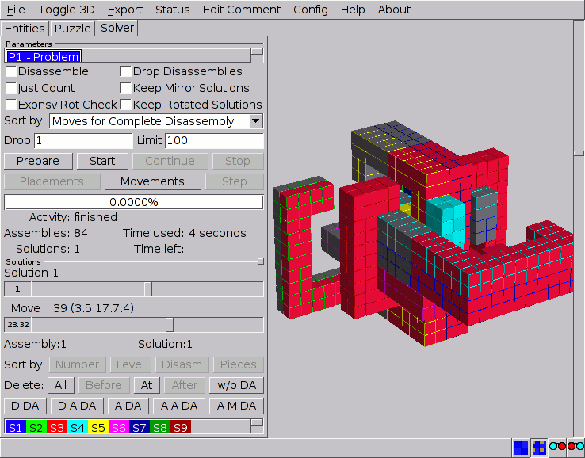
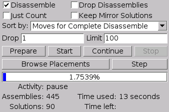
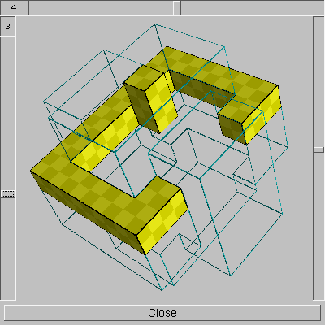

# Solving Puzzles {#ChSolver}

Solving puzzles is what BURRTOOLS is really about. Without its solving engine
the program would be nothing more than a simple tool for drawing a very
specific kind of 3-D objects... a task a lot of other software is no doubt even
better suited for.

Solving puzzles is very straightforward with BURRTOOLS even if the ***Solver***
tab (Figure [Solver](#FigSolver)) has quite a few controls. On top there is
the *Parameters* panel that contains a list allowing you to select a
specific problem to be solved, provides option settings for the solver, and has
a series of buttons to direct the solving process. Finally, some information on
the ongoing solving process is presented.

<figure id="FigSolver">

<figcaption>Figure: Solving puzzles</figcaption>
</figure>

A second panel (*Solutions*) has the tools to browse the different
solutions found, animate the moves to disassemble the puzzle to *inspect* the
solutions in detail, and to organize the solutions that have been found.

## Solver Settings {#ChSolverSettings}

In order to make the solver run, a problem must be selected first. A list of
all previously defined problems is available right below the ***Parameters***
caption. Selecting problems to be solved is similar to selecting shapes,
colours, or problems on the other tabs. Note that only the selected problem
will be solved, and that solving one problem will preserve the results of any
already solved or partially solved problem. Currently there are the following
options for the solver. All deal with the kind of information the solver will
report.

***Disassemble***
:   When checked, the solver will try to disassemble any assemblies found, and only
those that indeed can be disassembled will be added to the list of solutions.
If this option is left unchecked, the solver will merely search for all
*theoretically* possible assemblies, i.e. assemblies for which the pieces do
not overlap. Since solving disassemblies takes time (and often far more than
assembling), it's recommended to leave this option unchecked for puzzles that
always can be disassembled (e.g. PENTOMINO problems and other packing
problems). For that kind of puzzles, running the disassembler would only slow
down the process without any gain in information.

***Just Count***
:   When checked, the solver will only count the number of solutions; it will drop
the solutions right after they are found. Check this option if you're
interested only in the number of solutions and not in the solutions themselves.

***Drop Disassemblies***
:   When checked, the program functions the same as with *Disassemble*
enabled, except that the disassembly is *not* stored, only the assemblies and
some information *about* the disassemblies (like their level). This is useful
if you have a problem that has many solutions and you want to find the most
interesting solutions. Disassemblies take up a lot of memory within the
computer so it is useful to just save some information while solving the puzzle
and then later on, when everything is finished, recalculate the disassemblies
for the interesting solutions.

***Keep Mirror Solutions***
:   When this box is checked, the program will not remove mirror solutions. Two
solutions are mirror solutions are solutions when one solution is a real mirror
of the other. This can happen only, when either all pieces are self mirroring
(note that all flat pieces are self mirroring) or they have a mirror pair in
the piece set. Sometimes it is possible to create the mirror solution by
flipping the solution over. These are *not* mirror solutions to BURRTOOLS and
are still removed. This option is useful when using piece ranges, as the mirror
removal would remove too many solutions, like solutions with different piece
sets.

***Keep Rotated Solutions***
:   When this box is checked, the program will not exclude solutions that are only
rotations of other solutions. So the final solution count will be wrong. It will
even be completely unpredictable somewhere in the range of the right number of
solutions and a 120 fold of that value (for spheres). This option is useful if
you just want to know if there are any solutions *at all*.

***Expnsv Rot Check***
:   When this box is checked, BURRTOOLS will do a more thorough but also more CPU time
consuming check for double solutions. The basic idea behind it is explained
in the chapter about [Rotation Removal](#ChRotationRemoval2). A use of this
switch is explained in the [piece generation example](#ChPieceGeneration)

***Sort by***
:   This option lets you choose the order in which the solutions are presented
while the solver runs. There are 3 possibilities:

- unsorted: The solutions are sorted in the order in which they were found.
- by level: The solutions are sorted by the level. First by the number of moves
  to remove the first piece, if that is identical then by the moves for the
  second piece, and so on.
- by number of moves to disassemble: The solutions are sorted by the sum of all
  moves required to completely disassemble the puzzle.

***Drop***
:   If a puzzle has very many solutions, it might not be necessary or even possible
to save all of them. E.g for polyomino-like puzzles it might be nice to keep
just every 1000th of the millions of solutions, so as to have a profile of the
possible solutions. Here you can specify every how many-th solution you want to
keep. A 1 means you keep every solution, a 100 means you keep the first and the
101st and the 201st and so on.

***Limit***
:   Limits the number of solutions to be saved. There will never be more than the
specified number of solutions in the list. When the list is full the program
has 2 choices:

- Solutions are sorted: The programs throws away the solutions at the end. So
  low level solutions are removed.
- Solutions are unsorted: The program starts to throw away every 2nd
  solution. So if you started with a drop-value of one and the list is full,
  the program starts to drop every 2nd solution it finds, and only adds every 2nd
  solution to the list. But for each added solution it also removes every 2nd
  solution that was already added to the list. After a while the list contains
  only every 2nd solution — then the program only adds every 4th solution and
  removes again every 2nd solution that had been on the list, and so on. This
sounds complicated but what is does is ensure you have an nice cross-section of
all the solutions, and not just the first or last N found.

Solving uses all CPU cores you allow it: the search is split into independent
pieces that worker threads explore in parallel, while found assemblies are
disassembled concurrently in the background. The number of worker threads is
set with *Worker Threads* in the settings dialogue (→[Settings Dialogue
ChConfigMenu]). Because the threads divide the work dynamically, solutions may
be *found in a different order* on each run. The *set* of solutions is
always the same, but with *Drop* thinning enabled the subset kept can
differ between runs.

A paused or stopped search can be saved into the puzzle file and continued
later without repeating solutions already found: just save the puzzle while
the solver is paused or after stopping it, and press ***Continue*** after
reloading. Note that a paused search saved by a newer version of BURRTOOLS
generally cannot be continued by an older one, so finish long solves before
updating.

## Solving Puzzles

Next to the solver options are some buttons to direct the solving process.
Problems can be solved either in an automatic way or (manually) step-by-step.

### Automatic Solving

An automatic search will proceed until all solutions, i.e. assemblies and
disassemblies (when requested), are found. To begin an automated search, click
the ***Start*** button. Typically the solving process consists of a preparation
phase followed by several cycles of assembling and disassembling. The latter is
of course omitted when the *Solve Disassembly* option is left unchecked.

The automatic solving process can be interrupted by clicking ***Stop***, but
often the solver needs to finish some tasks first before it can actually halt
(→[Solver Information](#ChSolverStateInformation)). Any interrupted solving process
can be saved to the puzzle file and be resumed in another session with
BURRTOOLS. In fact, on loading such a partially solved puzzle BURRTOOLS will
inform you about the possibility to continue with the search for solutions.

When the solver is interrupted, the shapes (→ Chapter [Shapes](#ChShapes))
and/or the problems (→ Chapter [Puzzles](#ChPuzzles)) can be
edited. If no editing whatsoever of these has been done, the solving process
can be simply resumed (***Continue***), otherwise you need to start all over
again. But keep in mind that the saving of the internal state of the solver is
very version dependent. So it is likely that a new version of BURRTOOLS cannot
resume solving a puzzle saved with an older version. So it is good practice to
finish solving jobs with one version of BURRTOOLS before updating to the next.

When the solver is running it provides a lot of information about what it is
doing and an estimate of the time it will need to finish the search. All this
information is presented on six lines immediately below the solver control
buttons (Figure [Solver Information](#FigSolverInformation)). Keep in mind
that the estimated time to finish can be off by a very big amount. It happens
often that the figure starts with ages and millennia and then the solving is
finished within a few seconds, so be careful not to give up too soon.

<figure id="FigSolverInformation">

<figcaption>Figure: The solver information</figcaption>
</figure>

#### Solver Progress Information

The first line of the solver information is a progress bar indicating the
percentage of work it has done. The fifth (***Time Used***) and the sixth
(***Time Left***) line respectively show the time already spent on the search
and an estimate of the time still needed to finish the solving process. Note
that these are *very rough estimates* since these are based on the possible
placements of the pieces already tested and still to test. However, the
possible placements to be tested are constantly fluctuating as they are
determined by the positions of previously placed pieces (→ [Browsing
Placements BrowsingPlacements]).

#### Solver State Information {#ChSolverStateInformation}

Probably most important is the ***Activity*** and result information provided
by the solver. The *Activity* line tells you not only what the solver is
currently doing, but also whether the solver can be interrupted or not. The
following is an overview of the activities of the solver:

nothing
:   This indicates that the solver is ready to be started (provided a valid problem
is selected) and that no information is available about earlier attempts to
solve the selected problem.

prepare piece *n*
:   The solver is creating the internal data structure for the assembler. This
structure is more or less a listing of all the possible places that all the
pieces can go.

optimize piece *n*
:   In this second stage of the preparation, the placements for each piece are
tested for plausibility. Some placements are just nonsense in that they result
in unfillable holes or prevent the placement of other pieces. These placements
are removed from the data structure (→ [Browsing Placements](#ChBrowsingPlacements)).

assemble
:   The program is currently searching for assemblies.

disassemble
:   An assembly was found and is now being tested for disasembability.

pause
:   A search was started and interrupted.

finished
:   The search has been completed, all the solutions found, ordered by the set up
sorting criterion, can be inspected (→ [Inspecting Results](#ChInspectingResults)).

please wait
:   The user wanted to stop the search, but the program still has to finish what it
is doing right now. Only the assembler is interruptible. The preparation and
optimisation stages need to be finished. The disassembly search also has to be
finish before halting.

error
:   Something is wrong with the puzzle and an error message, providing more
specific information on the error, is usually displayed.

Finally, the solver gives information about the ***Assemblies*** found thus far
(i.e. assemblies for which the pieces do not overlap in 3-D space) and
***Solutions*** or disassemblies (i.e. assemblies that also can be constructed
in real life using the particular pieces of the puzzle). Note that the
*Solutions* are reported (and in fact tested) only if the
*Solve Disassembly* option is enabled.

### Manually Solving

Besides the automated search, *BURRTOOLS* allows you to run the solver
step-by-step. Note that this feature is still under construction and that it
has a lot of shortcomings. For instance, it won't add the solutions it finds to
the list or update the solver information. So it certainly needs a lot of
improvements in a future release of the program. For the time being it is
useful only to check the assembly process when something went wrong with the
automated search.

It is also very useful to check, if your colour constraints are correctly
defined as you can quickly see what placements are checked by the program. So
you quickly see when the program tries invalid placements for some or all
pieces of your puzzle. The same can be done in the placement browser.

A manual search needs the initial preparation phase as well as an automatic
search. This can be accomplished by clicking ***Prepare***. The solver will
halt after this initial phase and the subsequent steps of the assembler can be
seen in the 3-D viewer by clicking the ***Step*** button.

## Browsing Placements {#ChBrowsingPlacements}

The ***Browse Placements*** button opens a window (Figure
[Placement Browser](#FigPlacementBrowser)) that lets you examine the
positions for each piece that will by tried by the assembler. The placements
displayed in this window are the possible positions left in the current state
of the assembler. So if the assembler has placed a piece S*a* and this
prevents placing another piece S*b* at some positions, those positions of
piece S*b* will *not* be visible in the list. If you want to see every
placement tried, you have to either initialise a manual search (click the
*Prepare* button), stop the assembler before is starts to do anything
(click *Stop* while in preparation or optimisation stage), or wait until
the assembler has finished its work.

<figure id="FigPlacementBrowser">

<figcaption>Figure: Placement browser</figcaption>
</figure>

The ***Placement Browser*** window (Figure [Placement Browser](#FigPlacementBrowser))
has a very simple layout and consist mainly of a 3-D viewer and some
additional scrollbars. This 3-D viewport, which shows the outline of the result
shape and therein the shape for which the possible positions are to be
analysed, behaves similar to the viewport in the main window. Drag the piece to
rotate it in space and use the scrollbar on the right to zoom in or out.

Each piece in the problem (including each instance of a multipiece) can be
selected with the scrollbar on top of the window. The left scrollbar allows
browsing all the different placements for the selected piece. Both these
scrollbars can also be controlled with the cursor keys on the keyboard:
`[Up]` and [`Down]` for the left scrollbar and `[Left]` and `[Right]`
to select the piece. Be careful though, the first stroke on the keyboard that
doesn't fit the current scrollbar will just select the other one and the
following keystroke will start to move the slider.

## Browsing Movements {#ChBrowsingMovements}

Once you have found assemblies it is possible to analyse possible movement
within those assemblies. This is done with the movement browser. This tools is
still very simple and will probably be changed completely some time in the
future, but for now it could already be useful. As the tool will change later
on just a short introduction.

The tool is opened by pressing the "Movement" button on the solver tab. The
tool will then start with the currently active assembly.

The browser has a tree (like a directory tree) and some tool buttons on the
left and the usual 3-D view on the right.

In the tree on the right each node represents the possible states that the
puzzle can have. Each state is a relative position of all pieces towards each
other. The root of the tree is the initial state and sub-nodes represent state
that can be reached from there. The label on sub-nodes tells which pieces are
moved into what direction.

The button below the tree allow you to analyse one node and add all its
children.

If you activate a node the 3D view will display the positions of all pieces for
this node. Normal positions are displayed with filled shapes and coordinate system
along each piece. If you view invalid states, where pieces overlap you will see
the piece shapes only as wire-grid and the overlapping region as red voxels.

You can also analyse movements manually by adding a node and specifying which
pieces should move in which direction. If the pieces then do overlap the 3-D
view will change and display the overlapping voxels instead of the real shapes.

Finally it is possible to add a movement by blicking on faces of shapes in the
3-D view. If you press the shift key when clicking you will push the piece,
when pressing ctrl with the click you will pull the piece.

## Inspecting Results {#ChInspectingResults}

As soon as any result is found, the solutions list becomes available on the
***Solutions*** panel and the 3-D viewer shows the first solution in the list.
Note that subsequent solutions are simply added to that list, and that they can
get sorted by the total number of moves (in case disassembly was requested)
after the search is completed. All solutions that have been found can be
inspected at any time, this does not interfere with the ongoing solving
process. But completing the search and resetting the scrollbar for browsing the
solutions may be needed to show the solutions properly ordered.

This panel has four components:

- a scrollbar (***Solution***) to browse the different solutions,
- a second scrollbar (***Move***) to view the moves involved in the
  disassembly,
- an array of buttons with very short labels to organize the solution list, and
- a list of all instances of the pieces in the puzzle problem, which allows you
  to alter their visibility in the solution(s).

### Selecting Solutions and Animating Disassemblies

By moving the slider of the top scrollbar (***Solution***), any solution from
the list can be selected as is indicated by its number in the text box left of
the it. Above the scrollbar there is an indication of the total number of
solutions in the list. When the scrollbar is active it can also be controlled
by the `[Left]` and `[Right]` cursor keys. Keep in mind that the number of
solutions in the list may be different from the real number of solutions. The
correct number of solutions for the problem is shown in the solver progress
section.

The second scrollbar (***Move***) also has a text box on the left, this time
reflecting the stage of disassembly (i.e. the number of moves executed in the
disassembling process) of the currently selected solution. Moving the slider to
the right will animate the disassembly, moving it to the left will reassemble
the pieces in the 3-D viewer. Again, when activated the scrollbar can be
controlled by the `[Left]` and `[Right]` cursor keys. Above this scrollbar
is shown the *total* number of moves required for the disassembly, followed
by the level(s) of the selected solution. Note that this scrollbar is visible
only for solutions that have disassembly instructions available.

The position of the *Move* scrollbar isn't affected by selecting any other
solution, and thus allows easily comparing the different solutions at a
particular stage in the disassembly process.

Below the *Move* scrollbar are 2 fields that show you 2 numbers associated
with the currently selected solution. The first is the assembly number and the
second is the solution number. Both numbers define when a solution was found.
The first assembly found gets assembly number one. But for example that one
might not be disassembable so it gets thrown away. The second assembly found
gets assembly number two, and if it is also disassembable it gets solution
number 1. So you will see assembly 2 and solution 1 in these 2 fields for the
given example.

### Optimizing Disassembly Animations {#ChOptimizingDisasmSequences}

When BURRTOOLS generates the assembly animation it tries to optimize the piece
movement by always moving as few pieces as possible. So if you have a puzzle
made out of 7 pieces and in one move a group needs to move in one direction
BURRTOOLS will check if that group contains at most 3 pieces. If so it will
move those 3 pieces in the required direction. If it finds though that there
are more than 3 pieces it will rather move the other smaller group in the
opposite direction.

This "smallest group selection" can be overwritten with the weight parameter
of shapes. Each weight has a weight attached. Normally this weight is 1. Now
BURRTOOLS will always look for the group containing the shape with the biggest
weight and that group will stay put while the other group will move
disregarding the number of pieces in those groups.

This is useful if you have box packing puzzles. When generating disassembly
animations for those puzzles you normally want the box to not move while the
pieces inside the box move around. Simply give the box a weight of 2 and leave
the weight of the pieces as 1 and you will have a rock solid box.

To see examples of this look at the Pelikan Puzzle or Al Packino from the
[examples](#ChExamples).

### Handling Solutions

The big button group below the Solution selector and animator lets you modify
the solutions. They are activated only when no solver is running.

With the buttons in the first row you can re-sort the solutions by the same
criteria as you can select for the solver. You can sort them in the order they
were found (unsorted) or by level or by sum of moves to completely disassemble
and additionally be the pieces that are used in the solution.

Sorting by pieces means that the solutions using the same pieces are next to
each other in the list, and solutions using the first pieces come in the
beginning of the list while solutions using the last pieces in the problem are
at the end.

The second row of buttons allows the deletion of certain solutions from the
list.

***Del All***
:   removes all solutions

***Del Before***
:   removes all solution before the currently selected solution. The selected
solution is the first one in the list that is not removed

***Del At***
:   removes the currently selected solution

***Del After***
:   removes all solutions behind the currently selected one. The selected on is the
last one that is kept

***Del w/o DA***
:   remove all solutions that have no disassembly

The last row of buttons allow the addition or removal of disassemblies to the
list of puzzles.

***D DA***
:   deletes the disassembly of the currently selected solution. The disassembly is
replaced by data containing only information *about* the disassembly, so you
can still sort the solutions

***D A DA***
:   deletes all disassemblies

***A DA***
:   adds the disassembly to the currently selected solution

***A A DA***
:   add the disassembly to all solutions. Already existing disassemblies are thrown
away

***A M DA***
:   add the disassembly to all solutions that do not have one. Solutions that
already have a disassembly are left unchanged

### Visibility of Pieces {#ChVisibilityOfPieces}

In the list at the bottom of the *Solutions* panel, all pieces used in the
problem are represented by their identifier. Instances of multipieces have a
counter added to their prefix which now takes the form '***Sx.n***' and their
default colour may be slightly modified to tell them apart.

By clicking an identifier, the visibility state of that particular piece is
altered in the 3-D viewer. Each piece can have three states: *visible*,
*outlined*, or *invisible.* Clicking an identifier repeatedly just cycles
through these states and also alters the way the identifiers are depicted in
the list. These features are very useful in designs for which the pieces are
packed in a box, since the box would hide most of the action that is going on
inside (e.g. AL PACKINO, → Appendix [Examples](#ChExamples)). Also they are
very useful for inspecting the interaction of a few pieces and allow comparison
between different solutions, as the visibility states remain invariant in
selecting solutions.

Additionally it is possible to set the visibility state of a piece to invisible
by pressing `[Shift]` and then clicking onto the piece in the 3-D viewer.
This is handy when using custom colours and the default colour is not visible
or when there are many pieces and the distinction by colour becomes hard.

By default the pieces that become separated from the rest gradually fade out
during the final move. Sometimes this is unwanted as it may hinder a clear view
on what's going on. This can be avoided by unchecking *Fade Out Pieces* on
the options window (reached through *Settings* on the menu bar).

As not all pieces are used in all solutions, the list of pieces shows only the
names of those pieces that are really used in the currently selected assembly.
All other boxes become very small and contain no name. This should help to
quickly find out which pieces are used and which piece on screen corresponds to
what item in the piece visibility selector.
