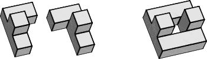
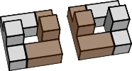

# Getting Started

## Introduction

This user guide is written from a *procedural* approach. Rather than
sequentially describing the elements of the GUI and their functions, this
manual guides you through the program the way you should create your first
design. Terms may be briefly repeated at several places in the text.

Throughout the text the following fonts and notations are used:

Roman: This font is used for the main text.

*Roman Italics*: Italics are used to emphasis words or sentences in the main text.

**Roman Bold**: Used for titles, subtitles and *concepts*.

*Sans Serif*: Used for elements of the GUI. The same wording is used as in the GUI.

**_Sans Serif Bold_**: Used for elements of the GUI and indicating that an in-depth explanation follows.

CAPITALS: Used for program names and puzzle names.

`Typewriter`: Used for file names, directories, URL's and code examples.

`[Typewriter]`: Between square brackets. Denotes a keyboard command.

→ Followed by a link: Points to more information on the subject.

A note regarding the screen-shots in this manual. They don't always show
the very latest version of the program. Only in the sections where a certain
element of the GUI is explained you can be reasonably certain that the image is
recent enough to contain the elements explained. It is just too much work to
always keep all screen-shots up to date.

## Installing BurrTools

### Downloading BurrTools

BURRTOOLS is an *Open Source* software project, released under the *GNU General Public Licence*. The most recent release of
the program is always available for *free* download on GitHub:

[latest release on GitHub https://github.com/burr-tools/burr-tools/releases/latest]

There are ready-to-run builds for Windows, macOS and Linux, plus the complete
source code. Every download includes the `examples` folder with dozens of
ready-to-open puzzles that illustrate the capabilities and functions of
BURRTOOLS. A brief overview of the examples is presented in the
[Example section](#ChExamples).

### Installation of BurrTools

#### Microsoft Windows

Download the `-windows-x86_64.zip` archive and unpack it anywhere you like.
No installer is needed: run `burrtools.exe` to start the program, and no
traces are left on your system when you delete the folder again. The archive
also contains the command-line solvers `burrTxt.exe` and `burrTxt2.exe`.

#### Mac OS X

Download the `.dmg` for Apple Silicon, open it and drag the app into your
`Applications` folder. On the first start macOS may complain that
"BurrTools.app is damaged and can't be opened". This is only the Gatekeeper
quarantine flag on unsigned downloads; clear it once with:

`xattr -cr /Applications/BurrTools.app`

After that the app starts normally. Puzzles can be opened by double-clicking
them in Finder or by dropping them onto the Dock icon.

#### Linux / Unix

Download the `-linux-x86_64.tar.gz` archive, unpack it and run
`./burrtools`. The archive also contains the command-line solvers
`burrTxt` and `burrTxt2`.

To build BURRTOOLS yourself from the source code (which is also how you get
the Python bindings), follow `BUILD.md` in the source tree. You need a C++20
compiler, Meson and Ninja; the `just` recipes take care of the rest.

## Concepts and Definitions

Before we start describing the functions of BURRTOOLS, let's synchronise our
use of vocabulary and explain a few concepts that are crucial to the way
BURRTOOLS works.

### Definitions

**Voxel**
:   A voxel *(volume element)* is a space unit in the 3-D space. The shape of the
voxels is defined by the space grid type. Currently BURRTOOLS supports cubic
voxels, triangular prisms, tightly packed spheres, and two types of grid made
from tetrahedrons. Each voxel has one of the following three states: *Empty*,
*Fixed* (*Filled*) and *Variable* (→ [Concepts](#ChConcepts)).
Additionally each voxel can also contain supplementary information in the form
of colours that are attached to the whole of that voxel.

**Spacegrid**
:   The spacegrid defines the shape, orientation and arrangement of the voxels.
Right now there are 5 space grids available in BURRTOOLS: cubes, prisms with a
equilateral triangle as base, tightly packed spheres, rhombic and
tetrahedral-octahedral tetrahedrons. Spacegrids are always fixed and periodic.
That means that a voxel in a certain position will always have the same shape
and orientation. So a spacegrid defining, for example, all Penrose patterns is
not possible because these are neither fixed nor a periodic patterns.

**Shape**
:   This is a definition of a 3-dimensional object. Shapes are assembled out of
voxels.

**Piece**
:   A piece is a shape that is used as a part of the puzzle.

**Multipiece**
:   Some pieces may have the same shape. BURRTOOLS requires you to tell it that two
or more pieces do have the same shape, otherwise it will find all solutions
with all permutations. So a multipiece is a piece that's used more than once in
the problem.

**Group (also Piece Group)**
:   A collection of pieces (and/or multipieces) than can move with respect to each
other, but cannot be separated from one another. Denoted with {}.

**Result**
:   This is the shape that the pieces of the puzzle are supposed to assume once the
puzzle is assembled.

**Problem**
:   A problem in BURRTOOLS consists of a list of pieces and/or multipieces, a
result shape and possibly some constraints. You can have more than one problem
in a file, as it may be possible to have more than a single task with the same
set of pieces (e.g. Piet Hein's SOMA CUBE). In other words, a problem is a
statement about *what to do* with the pieces.

**Puzzle**
:   A puzzle is either a single problem or a collection of problems.

**Identifier**
:   A unique code to identify a shape, colour or problem. This consists of an
automatically assigned prefix to which a custom name may be added. The prefix
is already unique. It is a letter followed by a number. The letter is
different for all items that required identifiers, e.g. it is S for shapes, P
for problems and C for colours.

**Assembly**
:   An assembly is a physically possible arrangement of pieces (meaning the pieces
do not overlap in space) so that the resulting shape is formed. It is not
guaranteed that it is actually possible to get the pieces into the positions of
the assembly without using advanced technologies like Star Trek beaming.

**Solution**
:   A Solution is an assembly with instructions how to assemble/disassemble the
pieces.

**Assembler**
:   The part of the program or algorithm that tries to find all assemblies of the puzzle.

**Disassembler**
:   The part of the program that tries to find out how the pieces must be moved to
assemble the puzzle. It does this by trying to disassemble an assembly. Some
puzzles like PENTOMINOES don't require separate instruction how to assemble the
pieces. It suffices to know where the pieces are in the assembly. Other puzzles
require detailed instructions how to move the pieces to assemble the final
shape. That is why the task of finding the assemblies and creating
assembly/disassembly instructions are separated from one another.

**Solver**
:   A short name to refer to the assembler and disassembler as a unit or just one
of these without specifying which one.

### Concepts {#ChConcepts}

As described above, BURRTOOLS works with shapes which are merely a collection
of voxels that each can have either one of three different states: *empty*,
*fixed* or *variable*. Particularly the difference between fixed and
variable voxels has a great impact on the way the solver works and which
assemblies are considered to be valid and which are not. Besides that, the
validity of solutions can be further restricted by imposing colour constraints.

#### Voxel States

**Empty**
:   The empty state is rather superfluous as it can also be regarded as the absence
of any voxel. It is just used in the result shape to indicate the spots that
can't be filled at all (holes).

**Fixed (or Normal)**
:   The normal or fixed voxels *need to be filled* in the final result, otherwise
it is not considered to be a valid assembly.

**Variable**
:   The variable state is used to instruct the program that for a particular voxel
it is unknown whether it will be filled or empty in the final assembly. This is
required for puzzles that have holes in *undetermined* places (like all the
higher level six-piece burrs). All voxels that *might* be empty *must* have
the variable state in the result shape. Right now the variable state can only be
used in result shapes and the solver will pop up an error message whenever it
encounters a variable state in a normal piece.

#### Colour Constraints {#ChColourConstraints}

Colours allow you to add constraints to the possible placement of pieces. This
is done by assigning a colour to one or more voxels of the piece(s) and the
result shape (→[Adding Colour](#ChAddingColour)). Then you can set some
colour placement conditions for each problem
(→[Colour Constraints](#ChProblemColourConstraints)). The program will place pieces
only at positions that fulfil the colour conditions defined.

These colour conditions currently allow the definition of what coloured voxels
of the pieces may go into what coloured voxels in the result shape. The
*default colour* is special: it always makes a colour match. Voxels in a
piece that are in the default colour fit everywhere and default coloured voxels
in the result shape can accommodate any piece voxel, independent of its custom
colour.

Currently the assigned colour is interpreted as painting the whole voxel with
this colour, but in the future more advanced possibilities for colouring and
conditions may be added.

### Symmetry Considerations

This chapter contains some advanced material that might not be suitable or
understandable for first time readers. So you might skip it for the moment. It
is advisable though that you finally read and understand the information given
in the following sections as otherwise you might get into trouble interpreting
analysis results.

The way BURRTOOLS handles symmetries in the result shape and the found
assemblies tries to be as close to "normally expected behaviour" as possible.
But sometimes it does strangely, unexpected things. To understand that you
need to know how BURRTOOLS goes on removing rotated solutions.

#### Rotation Removal Algorithm

BURRTOOLS tries to avoid finding rotations of solutions in the first place by
placing certain pieces in only a few of its possible rotations. But this method
doesn't work in all cases so a more general solution needs to be found that can
detect rotated or inflected solutions and drop them when they are found by the
assembler.

As said this filter is placed after the assembler and before further processing
(disassembling, sorting into solution lists) of the found assemblies is done.
To be usable the filter must have one important property: it must be
independent of the already found assemblies. So what is not working is to save
a list of all found assemblies and compare the new one with the entries of this
list.

Apart from getting very slow when the list is becoming long, it requires that
all assemblies are saved and this can be a real problem when there is a huge
amount of assemblies for a problem.

So an other approach had to be used. This method works by "normalizing"
assemblies and only allowing normal assemblies to pass the filter all other
assemblies are blocked.

Normalizing in this case means to be able to always find one special
orientation out of all possible orientations of an assembly. If we, for
example, start with 2 assemblies that are identical assemblies with different
orientations. Each of these 2 assemblies has a list of other possible
orientations. The list do contain the same entries but in a different order due
to the different starting orientation. We must now be able to independently
identify one special orientation from both lists. And those selected
orientations must be identical.

This is achieved by applying a comparison operation on the assemblies and
choosing the smallest or the biggest assembly.

Once we have this operation we implement our filter by only letting through
assemblies that are identical to the "smallest" orientation out of all of its
orientations.

It is obvious that this filter blocks all bot one assembly when fed with all
possible orientations of one assembly.

This filter also works when removing inflections (mirror solutions) of an
assembly. For that it needs an additional thought though. After mirroring an
assembly it might happen that pieces that are not mirror symmetric become
invalid. They changed shape and became their own mirror shape.

This, of course, is a different assembly, maybe even a different puzzle so we
need to try to rectify this by replacing pieces with their mirror shape, if
that shape is available. So what we do is that we go through all pieces in the
assemblies and check if a piece is placed in a mirror orientations. If that is
the case we search if we have a piece with mirror shape for the current piece
and exchange those 2 pieces. The new piece is then placed in a non-mirror
orientation. If we have been able to remove all mirror orientated pieces from
the assembly we got a valid new orientation that will go into the comparison
operation. If there are pieces left in mirror orientation, the whole assembly
is invalid and will not go to the comparison.

Now all this sounds like a good thing and it works pretty well, but it has some
important consequences that will be explained in the next section.

#### The Mirror Paradox {#ChMirrorParadox}

This is probably the most important consequence of the rotation removal
algorithm. When not considered it will result in useless statistics about
puzzle solutions and generally rubbish puzzle analyses.

As we have seen BURRTOOLS will exchange pieces in the process of trying
to eliminate mirror solutions from a list of assemblies. This manipulation
will lead to unexpected results like missing solutions or different counts
of solutions containing a certain piece.

To understand that have a look at the figure
[Mirror Paradox Example](#FigMirrorParadoxExample) You can see 2 solutions to a
simple puzzle. Each solution contains 2 pieces. On closer inspection you will
see that each solution uses 2 identical pieces but the 2 solutions each use
2 different sets of 2 pieces each. The 2 piece pairs of the 2 solutions are
mirror shapes of one another.

<figure id="FigMirrorParadoxExample">

<figcaption>Figure: Pieces, Resuls and solutions for a Puzzle</figcaption>
</figure>

When the mirror removal of BURRTOOLS is enabled BURRTOOLS will only display one
of the 2 solutions. To explore this you can have a look at the demo file
`DemoMirrorParadox.xmpuzzle` included in the examples of BURRTOOLS.

This explains different numbers of solutions that contain the various pieces.
The overall number of solutions will be constant but the number of solutions
that contain a certain piece may vary depending on the actual implementation
of the "smaller" operation of the rotation removal filter.

To avoid this problem it is best to know when exactly is may happen and when
not. Here is a list of conditions:

- it will not happen when you have at least one shape in your puzzle that
  doesn't has a mirror symmetry. This shape needs to be always in the
  assemblies.
- it only happens when you use ranges because we need to be able to *not*
  use pieces. When always all pieces are used it can not happen

And now we need to know what to do about it. The first possibility is to
change your puzzle so that the problem can not happen. If that is not possible
you *must* check the checkbox *Keep Mirror Solutions*.

#### Shorten Waiting Times

Due to the nature of the rotation removal algorithm is may happen that the first
solutions found don't pass the filter. For big solutions with a big number of
pieces this waiting time might even be very long.

If you just want to know *if* there are solutions and don't need the precise
number you can check the checkbox *Keep Rotated Solutions*. In this
case the rotation removal filter is disabled and all found assemblies pass.

#### Rotation Removal 2 {#ChRotationRemoval2}

When I explained the Rotation Removal Algorithm I intentionally left out one
fact: BURRTOOLS will not create all possible orientations of the assemblies but
only those orientations that are required. Required are the rotations that are
in the symmetry of the result shape.

Normally a found rotation will fill up the result shape pretty well, it will
also normally have an identical outer appearance which means that the found
assemblies will have the same symmetry as the result shape. This fact is used
to save some work. Only those orientations are considered that are part of
the symmetry of the result shape.

Now this works pretty well in most situations. In some cases though it is
necessary to do a more complete analysis and remove more solutions. For
example: imagine are single cube is to be put into a 4x4 square. Everybody will
agree that there is just one solution. BURRTOOLS will find 3. In one solution
the cube is in the corner, one solution has the cube on the edge and one
solution places the cube into the middle of the square.

All 3 solutions are identical in external appearance. For BURRTOOLS though they
are different because BURRTOOLS always looks at the found solution in relation
to the result shape.

Sometimes this is not what we need. In that case you will need a more thorough
analysis that will remove all possible orientations and also translations of
the solution so that no 2 solutions exist that are just a translation, rotation,
mirror or a combination of those 3 of one another.

For this the above explained filter will *always* create all possible
rotations and additionally will shift those orientations so that they are
closest to the origin before submitting the result to the comparison operation.

BURRTOOLS can do that. See chapter [Solver Settings](#ChSolverSettings) for how
to activate this functionality and chapter [Piece Generation](#ChPieceGeneration)
for an example of its use.

## Notes for PuzzleSolver3D Users

BURRTOOLS was initially very much based on PUZZLESOLVER3D by André van Kammen
but, by now has diverged quite a bit from that. We strongly advise you to read
this user guide since there are some features in BURRTOOLS that work somewhat
differently to their counterparts in PUZZLESOLVER3D and there are also a lot of
functions that PUZZLESOLVER3D doesn't have. Below are the most prominent
differences that need your attention:

- BURRTOOLS doesn't handle holes automatically as PUZZLESOLVER3D does. This may
  at first sound like a disadvantage but in fact it isn't. Unless you select
  *'Outer limits of result must be filled'* on the solve tab, PUZZLESOLVER3D
  treats all cubes of the target shape as cubes that might be filled but don't
  need to be. But knowing which cubes *must* be filled speeds up the search
  process. The more there are of these (as compared to the total number of
  cubes), the faster the solver will run, as fewer possibilities are left to
  test. BURRTOOLS requires you to specify exactly which cubes in the result
  shape must be filled and which ones may be empty.

- The BURRTOOLS solver doesn't automatically detect multiple identical pieces.
  You need to specify if a piece is used more than once. If you just copy them
  the way you do in PUZZLESOLVER3D the program will find way too many
  solutions. For example, with Bruce Love's LOVELY 18 PIECE BURR it will find
  nearly 40,000,000 times as many solutions as there really are. So be careful.

- BURRTOOLS allows you to define multiple problems in a single session. So you
  can, for example, save all the SOMA CUBE (Piet Hein) problems within one
  single file.

- BURRTOOLS has no limits to the number and size of pieces. You can have as
  many pieces as you want and they are not confined to a grid of 24x24x24.

- There is no limit to the number of possible positions for the pieces. So
  BURRTOOLS won't stop and complain about too many placements. As long as your
  computer has sufficient memory the program will merrily continue working —
  even if it would take longer than the universe exists — to complete the
  search.

- BURRTOOLS supports other spacegrids besides the cube space supported by
  PUZZLESOLVER3D. This allows the design and analysis of completely new puzzles.

- BURRTOOLS knows piece ranges, which enables you to search for puzzles and not
  just solve them.

### Importing PUZZLESOLVER3D files {#ChImportingPS3D}

BURRTOOLS has capabilities for *importing* PUZZLESOLVER3D files. So there's
no need to redo your designs from scratch, although some post-editing may be
required because of the differences in handling duplicates of pieces and holes
in the puzzle.

There are 2 possibilities for the holes. Depending on whether the option `Fill outer Cubes` is enabled or not when you solve the puzzle with PUZZLESOLVER3D,
you must either make the inner cubes of the result shape or the whole shape
variable if you want to get the same results with BURRTOOLS. This can be done
with the tools described in section [Constraining Tools](#ChConstrainingTools).
With these tools you can make a shapes inner or outer cubes variable.

The duplicate pieces are handled automatically. BURRTOOLS adds all shapes to
the new puzzle and marks the duplicates. The unused shapes are marked as unused
and can be deleted if they are not required.
