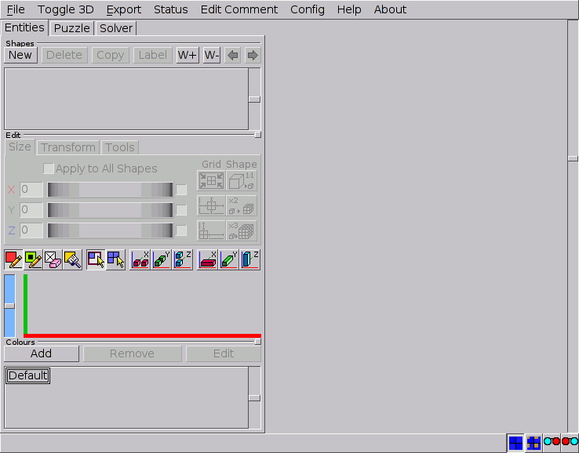
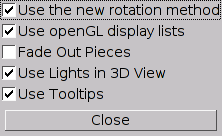
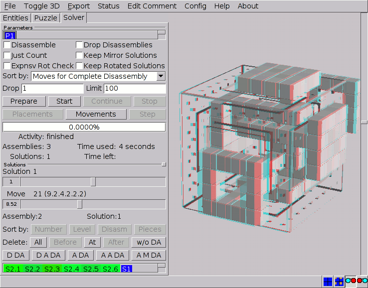
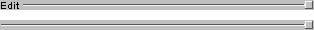

# The BurrTools Interface

When BURRTOOLS is started for the very first time the GUI will look like Figure
[MainWindowStart](#FigMainWindowStart) which shows the main window. Although
some small variations may occur depending on your operating system, screen
resolution, and display preferences settings. The GUI has four major parts. On
top there is a *menu bar* that allows handling of files and offers extra
functionality as well as some preferences settings for the program. At the
bottom there is a traditional *status bar* presenting relevant information
about the task at hand. In between there is a *tools section* on the left and
a *3-D viewport* on the right.

<figure id="FigMainWindowStart">

<figcaption>Figure: The main window on start-up</figcaption>
</figure>

## The BurrTools Menus

Below is a brief overview of the main menu entries with references to the
places in the text where a more detailed explanation is provided.

**_File_**
:   This menu holds the procedures for handling files within BURRTOOLS and for
exiting the program (→[File Menu](#ChFileMenu)).

**_Toggle 3-D_**
:   Swaps the 2-D and the 3-D grids for the *Entities* tab (→[Navigating in 2-D and 3-D](#ChNavigating)).

**_Export_**
:   Contains a sub-menu with 3 entries. One allows you to export the contents of the
3-D viewer that can be used to create high quality solution sheets
(→[Exporting Images](#ChExportingImages)). The next allows you to
create STL files for 3-D printers (→[Exporting to STL](#ChExportingSTL)).
The final entry exports the current content of the 3D-view
to a vector image (→[Exporting vector images](#ChExportingVectors))

**_Status_**
:   This opens up a window containing lots of possibly useful information about the
shapes of the puzzles (→[Chapter Status](#ChStatus)).

**_Edit Comment_**
:   Allows appending textual information to the puzzle file
(→[Adding Comments](#ChAddingComments)).

**_Settings_**
:   This menu item opens the preferences dialogue
(→ [Settings Dialogue](#ChConfigMenu)). On macOS it lives in the application
menu, as do *About* and *Check for Updates*.

**_About_**
:   Shows a window with some information about the program.

**_Check for Updates_**
:   Asks GitHub whether a newer BurrTools release exists and, if so, shows its
release notes with a button that opens the download page. A version can be
skipped. The same check can run automatically at startup (→[Settings
Dialogue ChConfigMenu]).

### The File Menu {#ChFileMenu}

The **_File_** menu has all the traditional entries for handling files. Many of
these are well known from other software and don't need much explanation. Some
of the items also have keyboard shortcuts as indicated in the menus. Prior to
executing most of these commands a warning (and option to cancel) is given
whenever changes to the current design haven't been saved yet.

**_New_**
:   Starts a new design after removing all the information of the current one. The
first thing that happens when you start a new puzzle is that you will be asked
which spacegrid to use. When BURRTOOLS is started it defaults to using the
cubes spacegrid, so if you want to use another grid you need to use this menu.

**_Load_**
:   Opens a BURRTOOLS `*.xmpuzzle` file. A notification will pop up when a
*partially* solved design is loaded. Short cut: `[F3]`.

**_Import_**
:   This entry opens a traditional file dialogue that allows importing
PUZZLESOLVER3D files (`*.puz`) into BURRTOOLS. Although these imported
designs often can be subjected to the solver right away, some postediting may
be required because of the differences in the way BURRTOOLS handles holes in
the result and duplicated pieces. BURRTOOLS will import *all* the pieces from
the `*.puz` file and assign them to the shapes S1 to Sn-1. Accordingly,
the *result* from the PUZZLESOLVER3D file will be assigned to the last shape
(S*n*). Also a problem definition is automatically created (→Chapter
[Puzzles](#ChPuzzles) and [Importing](#ChImportingPS3D)).

Since all imported shapes consist only of fixed voxels, the result shape may
need some editing (puzzles that have internal holes or pieces not filling the
outskirts of the result shape) to make the solver run. Also, duplicated pieces
should preferably be deleted from the *Shapes* list
(→[Creating Shapes](#ChCreatingShapes)).

**_Save_**
:   Saves your work into a `*.xmpuzzle` file. If the design had not been saved
before (indicated with '`Unknown`' in the BURRTOOLS windows title bar) the
*Save As* command will be activated. Short cut: `[F2]`.

**_Save As_**
:   Allows you to save any changes to a new file, thus keeping the original design
the way it was.

**_Convert_**
:   Allows you to convert the current puzzle from its current gridtype into another
grid type (→Chapter [Converting Shapes](#ChConvert)

**_Import Assms_**
:   With this menu entry you can import a set of existing assembly solutions of one
problem as new shapes into your puzzle
(→Chapter [Importing Assemblies as Shapes](#ChImportAssms))

**_Quit_**
:   Shuts down BURRTOOLS.

Except when the solver is actually *running*, saving your work is always
possible. This means that after stopping (pausing) the solver it is possible to
save the results found thus far. Later on these partially solved puzzles can be
loaded again and the solving process may be resumed. This allows you to subject
'huge' problems (e.g. "Coming of Age" from Brian Young) to BURRTOOLS
and have them solved in several sessions overnight or whenever you don't need
your computer for other tasks.

### The Settings Dialogue {#ChConfigMenu}

The **_Settings_** item on the menu bar opens a new window (Figure
[settings dialogue](#FigConfig)) to set some options for the program. Every option is
explained right in the dialogue, and *Restore Defaults* brings them all
back to their factory values. These settings are stored in a configuration
file in your home directory and the program uses them each time it is started.

<figure id="FigConfig">

<figcaption>Figure: The settings dialogue (showing older options)</figcaption>
</figure>

**_Use Tooltips_**
:   By default BURRTOOLS shows tooltips for most of its controls, but to the more
experienced user these soon become very annoying. This option allows you to
switch these tooltips off.

**_Use Lights in 3D View_**
:   This option toggles the use of a spotlight in the 3-D viewer. When disabled,
the items in the 3-D viewport get a uniform (high) illumination, whereas
enabling this option provides a more rendered appearance of the objects by
adding a spotlight in the upper right corner of the 3-D viewport and shading
the faces of the objects. However, on some systems this may result in a
relatively dark left bottom corner that can hamper a clear view of the objects.

**_Fade Out Pieces_**
:   This option affects the way pieces that *become* *separated* from the rest
are depicted. Hence, the effects are visible only after running the solver
(→[Visibility of Pieces](#ChVisibilityOfPieces)).

**_Use openGL display lists_**
:   This option enables an optimisation for the 3-D viewer which makes it faster
when drawing complex shapes. Sadly it seems to be that some OpenGL
implementations don't properly support that option. So when you experience
crashes when you edit shapes or rotate something in the 3-D view, try disabling
this option. It is off by default.

**_Use new rotation method_**
:   This option allows you to toggle between the old way the shapes are rotated and a
new way. With the old method a shape always returned to the same orientation when
the mouse was dragged back to the starting position. The new method allows rotating
a shape by drawing circles on the screen.

**_Reverse scroll zoom direction_**
:   Reverses the direction the 3-D view zooms when you turn the mouse wheel.

**_Show View Cube_**
:   Displays the View Cube navigation widget in a corner of the 3-D view. Click a
face, edge or corner of the cube to snap the view to it with a smooth animated
rotation; the Home button resets pan and zoom. Turn this off if you find it in
the way.

**_Undo History Depth_**
:   How many editing steps the undo/redo history keeps: 25, 50, 100 or 200.
Higher values use more memory for large puzzles. Nearly every edit to shapes,
colours and problems can be undone with `[Ctrl+Z]` and redone with
`[Ctrl+Shift+Z]` (`[Cmd+Z]` / `[Cmd+Shift+Z]` on macOS); undoing also
takes you back to the tab where the change was made.

**_Worker Threads_**
:   How many CPU cores the solver may use for assembling and disassembling. Both
stages share this pool. The default is 60% of your machine's cores, so a long
solve still leaves room for other work; lower it if your computer should stay
fully responsive, raise it to the full core count for maximum speed.

**_Check for updates at startup_**
:   At most once a day, BURRTOOLS quietly asks GitHub whether a newer release
exists and, if so, shows its release notes with a button to the download page.
A version can be skipped, and *Check for Updates* in the menu performs the
same check on demand, whether this option is on or off.

## The Status Bar

The status bar has two parts. On the left is given information about the task
at hand, and on the right are two groups of buttons to alter the 3-D view.
The first group selects *how* the 3-D view shows the shapes. You have the choice
between the normal view where each piece is drawn with its default colour, or a
view where each piece is drawn with its colour constraint colour (if it has one
assigned →[Adding Colour](#ChAddingColour)). The last two options are for a mode
called *anaglyph* (see figure [Window Anaglyph](#FigWindowAnaglyph)). In this
mode the pieces are drawn using the red-cyan method to display real 3-D. You
can view these with red-green, red-blue, or red-cyan glasses. The icon shows
you which way around the colours must be in front of your eyes.

The second group selects the *render style*: each voxel drawn separately
(the classic look), flat faces with lines only at the real piece edges, or the
chamfered mesh that the STL export writes, so the preview shows exactly what a
printed piece will look like (→[Exporting to STL](#ChExportingSTL)). The choice
is remembered between sessions.

<figure id="FigWindowAnaglyph">

<figcaption>Figure: Disassembler in Anaglyph Mode</figcaption>
</figure>

## The Tools Section

In between the menu bar and the status line is the most important part of
BURRTOOLS: The section that allows you to submit existing puzzles to the
solver, but more even important lets you create and test your own designs.

### The Puzzle People

The tools section has three major tabs that might can be thought of by analogy
with real people in the world of mechanical puzzles. First there is the
*Entities* tab, which can be seen as the craftsman who *creates*
different *shapes* but is not concerned with their purpose of these
(→Chapter [Shapes](#ChShapes)). As long as his saw blade is sharp he's the
happiest man in the whole wide world. Next, we have the *Puzzle* tab. This
is the weirdo who thinks it's fun to come up with completely insane
*problems* to be solved with the otherwise very innocent objects produced by
our craftsman (→Chapter [Puzzles](#ChPuzzles)). However, his contribution to
the preservation of our planet is considerable... by saving a lot of wood
scraps from the incinerator. And last we have the *Solver*, the poor guy
who spends not only a great deal of his money on these finely crafted puzzles
but almost all of his leisure time on *solving* them
(→Chapter [Solver](#ChSolver)), only to feel very euphoric when he finally
succeeds. But scientists are still breaking their heads over the question
whether this is caused by the sweet smell of success, or is merely due to
severe sleep deprivation.

### Resizing the Elements

Although the layout of the GUI is designed to suit the needs of most users, it
sometimes may be useful to resize some elements for convenience in using
BURRTOOLS. Besides the traditional resizing of the main window, BURRTOOLS has a
couple of features to alter the relative importance of its controls.

First, the tools tabs can be made wider or narrower (thus making the 3-D
viewport more or less important) by dragging the right edge of the tools
section. Hovering your mouse pointer over that edge will make it change into a
left-right arrow, indicating that you can start dragging it.

Second, within each of the three main tabs some sections (panels) can be
resized as well. For example, if you have a design with many different shapes
but no colour constraints at all, reducing the size of all colour related
controls and maximising those concerning shapes could be very advantageous. The
panels on the tool tabs are separated by so called resize handles (Figure
[Resize](#FigResize)). The separators that allow resizing are easily
recognised by a little beveled square on their right end. Hover your mouse
pointer over the lines until it changes into an up-down arrow, indicating that
you can drag the separator up or down to resize the panel.

<figure id="FigResize">

<figcaption>Figure: Resize handles</figcaption>
</figure>

Note that each section has a minimum size. It is not possible to make it
smaller than that minimum size.

## The 3-D Viewer

Normally the biggest part of the GUI is reserved for the 3-D viewport. In fact
this 3-D viewer is threefold and has different properties for each of the tabs
of the tools section. For the *Entities* tab the 3-D viewport shows the
currently selected shape and reflects all editing operations performed on that
shape. Also the x-, y- and z-axes are shown to assist navigating in space.
With the *Puzzle* tab activated an overview of the current problem is
presented: the result shape (double sized) on top and a single instance of each
shape used as pieces below it. Finally, for the *Solver* tab, the 3-D
viewer can be used to browse all assemblies found and/or show an animation of
the moves involved in the disassembly of the puzzle.

Any object in the 3-D view can be *rotated* by simply dragging it, and the
scrollbar on the right allows *zooming* in or out on that object by
respectively moving the slider down or up or by using your mouse-wheel. Note
that the zoom settings are independent for each of the three tools tabs. For
precise orientation, click a face, edge or corner of the *View Cube* in the
corner of the view to snap to it with an animated rotation, or press its Home
button to reset pan and zoom (→[Settings Dialogue](#ChConfigMenu)).

Extra options for the 3-D viewer are available in the *Settings* dialogue
(→[Settings Dialogue](#ChConfigMenu)).

## Undo and Redo

Nearly every edit can be undone: voxel painting, shape transforms, colour
changes, adding, removing or renaming shapes and colours, and problem setup.
A continuous stroke, such as painting or deleting many voxels with one mouse
press, or a burst of rotations, counts as a single undo step, and undoing
takes you back to the tab where the change was made. Use `[Ctrl+Z]` to undo
and `[Ctrl+Shift+Z]` to redo (`[Cmd+Z]` / `[Cmd+Shift+Z]` on macOS), or
the corresponding menu entries. How many steps are remembered is set with
*Undo History Depth* in the settings dialogue (→[Settings Dialogue
ChConfigMenu]); the default of 25 is plenty for most designs.
