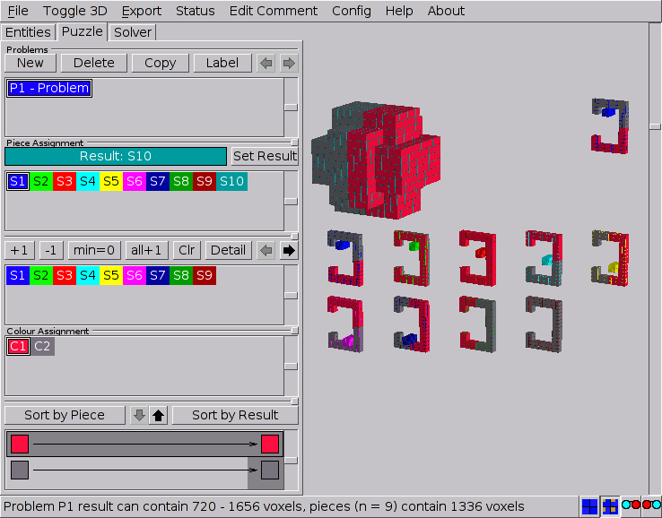
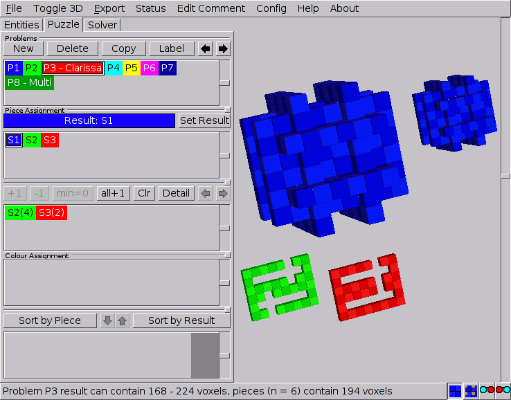
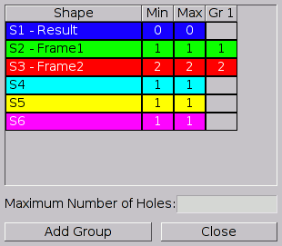
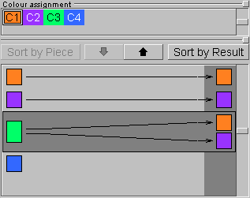
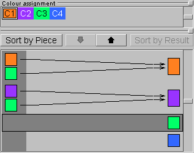

# Defining Puzzles {#ChPuzzles}

Typically a puzzle problem in BURRTOOLS consists of a collection of pieces
(shapes) and a goal, say another shape that the pieces should form when
correctly assembled. This is what we call a *simple problem definition*. Note
that it may well be not that 'simple' to solve it in real life. More elaborated
or *complex puzzle problems* contain also colour constraints and/or grouped
pieces.

As stated before, a puzzle can be a collection of problems, either simple,
complex or a mixture of both. The ***Puzzle*** tab (Figure [PuzzleTab](#FigPuzzleTab))
provides all the tools needed to build a variety of puzzle problems that are
suited for the *Solver*.

<figure id="FigPuzzleTab">

<figcaption>Figure: Defining problems on the Puzzle tab</figcaption>
</figure>

## Defining Simple Problems

As defined above, a simple puzzle problem consists only of a collection of
pieces and a result shape that can be assembled (and preferably also
disassembled) with these pieces (Figure [SimplePuzzleProblem](#FigClarissa)).
Bear in mind that a simple problem also implies that *all* the pieces can be
separated from one another. It takes only two steps (which are also required
for complex problems) to create such a problem: *initialising* the problem
and *assigning* shapes to the pieces and the result.

### Initialising Problems

The first step is to *initialise* the problem(s). All the tools to do so are
just below the ***Problems*** caption. Just as with shapes, this can be done by
clicking the ***New*** button to start a completely new one, or by using
***Copy*** to edit a previously created problem definition without destroying
the original. Accordingly, problems can be removed with the ***Delete***
button. All problems find their place in the problems list below these buttons
and are identified with a '***P*x****' prefix to which a more meaningful
description can be added by clicking the ***Label*** button. Also the methods
for selecting and rearranging problems are similar to their counterparts on the
*Entities* tab and need no further explanation here.

### Piece Assignment {#ChPieceAssignment}

Until now we dealt with shapes as rather abstract concepts. Only by
*assigning* these shapes to the pieces or the goal of a puzzle do they become
meaningful. All available shapes are presented in the top list of the
***Piece Assignment*** panel, in which they can be selected and be given their
purpose in the puzzle. Since a strict distinction is made between shapes and
pieces, it's not necessary that all shapes be used in a single problem or in
any problem at all.

<figure id="FigClarissa">

<figcaption>Figure: A simple puzzle problem with multipieces</figcaption>
</figure>

Although not mandatory, it's probably best to assign the result shape first:
select the appropriate shape and click ***Set Result***. The result shape is
then depicted in the top left part of the 3-D viewport (which also shows a
smaller example of the currently selected shape) and the status line shows some
information about the problem at hand.

Next, any other shape can be assigned to the pieces of the puzzle by selecting
it and clicking ***+1***. This adds a single copy of the shape to the second
list which holds all the shapes used as pieces. If multipieces are involved,
just add as many instances of the shape as required by the same means.

In the list of pieces any multipiece has an instance counter added (in
parentheses) to its identifier. A single instance of every shape used in the
puzzle is shown in the lower part of the 3-D viewer. To make corrections,
pieces can be removed from the puzzle by selecting them (they also can be
selected by clicking them in the pieces list) and clicking ***-1***. Again,
this removes only a single instance and needs to be repeated for removing
multipieces.

Most of the time it is necessary to add one instance of all defined shapes to
the puzzle. If there are a lot of them this can take while. This is what the
***all +1*** button is for. It increases the piece counter for each shape
(except the one assigned for the result) by one. Or it adds a first instance of
the shape to the problem. The ***Clr*** button removes all pieces from the
problem.

Since it doesn't make sense for any shape to be both the result and a piece at
the same time, the shape set as result cannot be added to the list of pieces.
Consequently, assigning a shape that's already in the list of pieces to the
result will remove it from the list.

Whenever the total number of cubes in the pieces is within the boundaries set
by the result shape (which can be inspected on the status line), this kind of
simple puzzle problems can be taken to the solver. Note that the solver won't
run if one or more pieces contain any variable voxels.

## Piece Ranges

BURRTOOLS is capable of handling piece ranges instead of a fixed number of
pieces. This feature is useful when you want to search for puzzles instead of
solving a given one. If there is a range defined for one or more pieces then
BURRTOOLS finds all ways to assemble the defined result using a number of
pieces within the given range. As an example let's take Ronald Kint-Bruynseels
Clarissa-Burr (see http://www.asahi-net.or.jp/~rh5k-isn/Puzzle/ClarissaBurr).
This puzzle consists of 2 different shapes.
When Ronald defined this puzzle he had to try all possible combinations of the
2 pieces, beginning with 6 pieces of shape A and zero of shape B, over 5 times
A and one B up to 6 times B. This can now be done way more easily with piece
ranges. Simply tell BURRTOOLS that the result should be made out of 0-6 pieces
of shape A and 0-6 pieces of shape B, or if you want to ensure that at least
one of each shape is used, use ranges 1-6. Then solve.

Piece ranges can be easily defined using the ***min=0*** button. This will set
the minimum of the piece range for the current shape to zero. With that you can
define the range by first adding max-min pieces (meaning the difference between
the maximum and the minimum number of pieces), then set the minimum to zero and
then add the missing minimum pieces. This should cover the most used usage cases.

For example: suppose you want to add a piece that you want to use 3, 4, 5 or 6
times in your puzzle. The piece range is 3-6. To enter those values you first
add 6-3=3 pieces. Then you press the ***min=0*** button getting a piece range
0-3. Now you add another 3 pieces and you get the range you want.

Except for the ***min=0*** button, all other buttons always change the minimum
and the maximum of the piece range.

If this calculation is too hard for you, you can use the problem detail
dialogue (see section [ProblemDeatils](#ChProblemDetails)) to enter the
ranges directly without the need for calculations.

## Grouping Pieces

Something we deliberately haven't mentioned in the description above is the
fact that the solver will halt whenever it is unable to separate some pieces
from each other. In other words, the solver will attempt to separate *all*
the pieces from each other and reports that no solution exists when it fails to
do so. This is just what is required for most puzzles as you need to have
single pieces as a starting point.

But there are a few puzzles for which you have groups of pieces that are
*movable* but *not separable*. Here the piece groups come in handy.
Probably some of you know how frustrating is is to not be able to analyse
a puzzle just because there are 2 pieces that are supposed to not go apart.
Not so with BURRTOOLS, as piece groups allow you to tell the disassembler that
it is OK when it cannot separate a few pieces from one another.

Another usage of this function is if you have 2 pieces that require a rotation
to come apart. BURRTOOLS will not be able to separate them, so you tell it that
those pieces may stay together.

### Concept

When the disassembler finds two or more pieces that cannot be taken apart it
checks whether all of the pieces involved are in the same group. If that's the
case it rests assured and continues. If the pieces are *not* in the same
group, the disassembler aborts its work and reports that the assembly cannot be
disassembled. This is the basic idea, but there is a bit more to it.

#### Complete Disassembly

A special case is *'Group-0'*. All pieces in this group *need to be separated*
from each other. This group is included so that it is not necessary to place
all the pieces into their own group when you want the puzzle to completely
disassemble. Pieces automatically go into Group-0, so you don't need to take
care of that. As a matter of fact you won't even find any reference to that
Group-0 in the GUI.

#### Basic Piece Grouping

On the other hand, when dealing with puzzles of which it is known that certain
pieces (say S*a* and S*b*) can't be separated from each other, grouping
these pieces will cause the solver to report a valid disassembly in which the
grouped pieces are treated as a single piece. But it is not a rigid piece since
the parts can freely (within certain boundaries) move with respect to each
other.

{S*a*, S*b*}

Group-1 → S*a*+S*b*

This technique can also be used for pieces that may be entangled, in case one
is searching for possible designs. If these pieces are indeed inseparable the
solver will report so, but if they can be separated the solver may report the
complete disassembly as well:

{S*a*, S*b*} ?

Group-1 → S*a*+S*b*

Result: {S*a*, S*b*} and/or S*a*, S*b*

Now for the hard part: *pieces can be in more than one group*. If you have
e.g. a puzzle for which you know that piece S*a* either interlocks with piece
S*b* or piece S*c* and cannot be separated from it, but you don't know
which of those (S*b* or S*c*) piece S*a* is attached to, you can assign
Group-1 to S*a*+S*b* and Group-2 to S*a*+S*c*:

{S*a*, S*b*} or {S*a*, S*c*}

Group-1 → S*a*+S*b*

Group-2 → S*a*+S*c*

This way the disassembler detects that both pieces are in Group-1 when S*a*
and S*b* are inseparable and it finds that both pieces are in Group-2 when
S*a* and S*c* cannot let go from each other. In both cases the solver will
report a valid disassembly. However, if S*b* and S*c* are entangled the
solver is not able to find a valid disassembly.

#### Grouping Multipieces

All instances of a multipiece need to have the same group assignment, but you
can specify how many of these may be in a group *maximally*. That means you
can make statements like 'not more than 3 pieces of S*n* *may* be in Group-1':

S*a_1*, S*a_2*, ... S*a_n*

Group-1 → S*a_1*+S*a_2*+S*a_3*

Now how does it all come together? The disassembler starts to do its work. For
each subproblem (a subproblem is a few pieces that it somehow has to get apart)
it first checks if there is a unique group assignment for all pieces involved
— i.e. all pieces have exactly one group assigned and that group is the same
for all of them — it doesn't even attempt to disassemble that subproblem.

If this is not the case it tries to disassemble. In case of a failure it adds
the pieces that are in this subproblem to a table of lists of pieces. Once
done with the disassembler, the program comes back to this table and tries to
assign a group to each of the lists of pieces. It just checks all possibilities
by comparing the entries of the table with the group assignments made by the
user. Whenever the sum of pieces (of a certain shape S*x*) in such a
'problematic' table entry is bigger than the value the user designated to that
particular piece, no valid group assignment can be made. If the program can
find a valid assignment the puzzle is disassembled; if it cannot, the puzzle is
assumed to be not disassemblable.

#### Example

Assume we have a puzzle that contains (among others) 5 pieces of shape S*a*.
Three of them might go into Group-1 and another 2 into Group-2. There is also a
piece S*b* that might go into Group-1:

Group-1 → S*a_1*+S*a_2*+S*a_3*+S*b*

Group-2 → S*a_1*+S*a_2*

After the disassembler has run we have the following lists of pieces in the table:

- S*a*, S*a*
- S*a*, S*a*, S*b*

Now the program has to assign Group-2 to the first set of pieces and Group-1 to
the second set of pieces. Because otherwise piece S*b* would be in the wrong
group, it can only be in Group-1. If there would be another piece S*a* in the
first set it would not be possible to assign groups because we can only have
two pieces S*a* in Group-2. But it would be possible to have another piece
S*a* in the second set.

We have no idea how useful this might be in practice as most of the currently
available puzzles require a complete disassembly. But who knows, maybe this
feature will help in the design of lots of puzzles new and crazy ideas.

## Editing Problem Details {#ChProblemDetails}

All settings that cannot be set directly on the main problem tab can be set
within the ***Problem Details*** window (Figure [GroupEditor](#FigGroupEditor))
which opens by clicking the ***Detail*** button. This window allows you to
define groups and to define piece ranges without having to subtract values. The
window also contains rarely-used parameters.

<figure id="FigGroupEditor">

<figcaption>Figure: The Problem Details Editor</figcaption>
</figure>

Let's first see how piece groups are defined using this window. Although the
above section may sound complicated, implementing piece groups is actually very
simple. All actions take place in the ***Problem Details Editor***. Initially
the *Group Editor* shows a tabulated overview of the pieces used in the
problem. The first column (*Shape*) lists the pieces by their prefix and
name, the second and third (*min* and *max*) show the instances range
of each.

Creating piece groups is straightforward as the ***Add Group*** button simply
adds a new group to the problem. Each new group gets its own column (*Gr 1*,
*Gr 2*, etc...) in which one can specify the *maximum* number of
instances of a certain piece that can go in that particular group. Just click
on a cell and it will become an input box. Cells that contain a value > 0 will
receive the default colour of the corresponding shape, cells with zero are grey
and no number is shown. Any group that has no values at all in its column will
be deleted on closing the *Group Editor*. Hence, deleting all the values of
a previously made group will remove the group even if its column stays present
in the *Group Editor*.

Now to the piece ranges. It is possible to enter the values directly into the
min and max columns of the table. You just have to keep in mind, that min has
to be less than or equal to max. This is enforced by the program, so that max
will change, if you enter a value in min that is larger than the current
maximum. The same holds true for the minimum, when changing the value in the
max column. You also need to keep in mind that the table contains entries only
for shapes that are already used in the current problem. You cannot (yet) add
another shape to the problem using this dialogue, but you can remove a shape by
setting the minimum and the maximum to zero.

Finally, this window also contains an entry field called ***Maximum Number of Holes***
(empty variable cubes). This value is used by the program, when piece ranges
are used, in which case it is not possible for the program to determine how many
holes there will be in the final solution. Because this missing information
results in a huge slowdown as many more possibilities have to be tried, it is
possible to use this field to specify the maximum number of holes allowed. If
the number of holes should not be limited, the field should be left empty.

## Setting Colour Constraints {#ChProblemColourConstraints}

BURRTOOLS automatically adds the most probable rules for colour constraint when
you add a new colour or when a new problem is created, namely that each colour
can be mapped into itself, i.e. a piece voxel with colour C*x* can go into
a result voxel of colour C*x*. If you don't want that or if you need
additional placement possibilities, you can change the colour constraint rules
in the colour assignment section.

The ***Colour Assignment*** panel (Figure [ColourAssignment](#FigColourAssignment))
has two lists. The first one shows all the available custom colours and allows
selecting a certain colour for which then some relations can be set. These
relations simply indicate which colour(s) in the result can accommodate which
colour(s) in the pieces. By allowing certain combinations (which is in fact
prohibiting all other combinations), constraints are imposed on the possible
placements of the pieces. These relationships are shown and constructed in the
second list. This list has three columns, of which the first shows the 'piece
colours', the last shows the 'result colours', and the one in between clearly
depicts the relationships by a series of arrows pointing from the piece colours
to the result colours. The list is sorted either by the piece colours or by the
result colours. The buttons ***Sort by Piece*** and ***Sort by Result*** switch
between these two views.

<figure id="FigColourAssignment">

<figcaption>Figure: Colour assignment</figcaption>
</figure>

When *sorted by piece* (the left part of Figure [ColourAssignment
FigureColourAssignment]), the bottom list is showing you that every voxel of
the pieces with colour C*x* can go into every voxel of the result that has
one of the colours at the end points of the arrows starting from Cx. When
*sorted by result* (on the right in Figure [ColourAssignment
FigureColourAssignment]), the list shows which piece colours will be allowed
to go in a particular colour of the result.

To set these relationships, first click the piece colour (or result colour,
depending on the sorting method) for which you want to set the constraints.
This will activate the 'relations line' for that particular colour which is
indicated with a dark surrounding box (note that clicking anywhere on this
relations line has the same effect). Next, the down and up pointing arrows will
respectively add or remove the colour selected in the top list to or from the
constraint settings.

## Managing Problems

Currently puzzle problems can be rearranged only with the left and right arrow
buttons of the *Problems* section, but more advanced management procedures
may be added in the future.

## Tips and Tricks

Maximum Number of Holes
:   Keep this value as small as possible, because the more holes a puzzle contains
the longer the solving will take. Normally the value is undefined, meaning the
number of holes is *not* limited. So if you know the number of holes you
want, or you want to limit them, or the solving takes too long, use this field.

Some tricks and tips will be added to the next update of the user guide.

### Grouping Tips

TBD

### Constraint Tips

#### The "At Least 2 Colours" Rule

There is one error that happens quite often to people (including me) when
working with colour constraints. I want to force certain pieces or parts of
pieces in certain positions. To do that I colourize the pieces and the target
positions.

When I solve I observe, that the pieces are still placed all over the place.
The problem is the neutral colour. It can accommodate all possible other
colours. So:

	**You need at least 2 colours for a placement constraint**

For a real placement constraint you need to use at least 2 colours. One colour
on its own can be only usable for marks on the pieces, or to colourize the
pieces for a nicer display.
